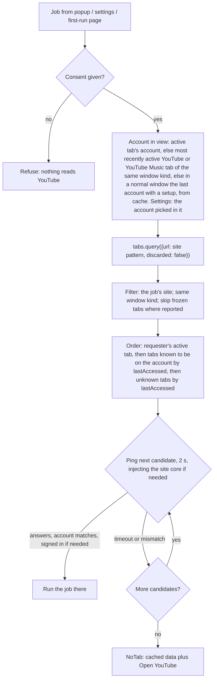
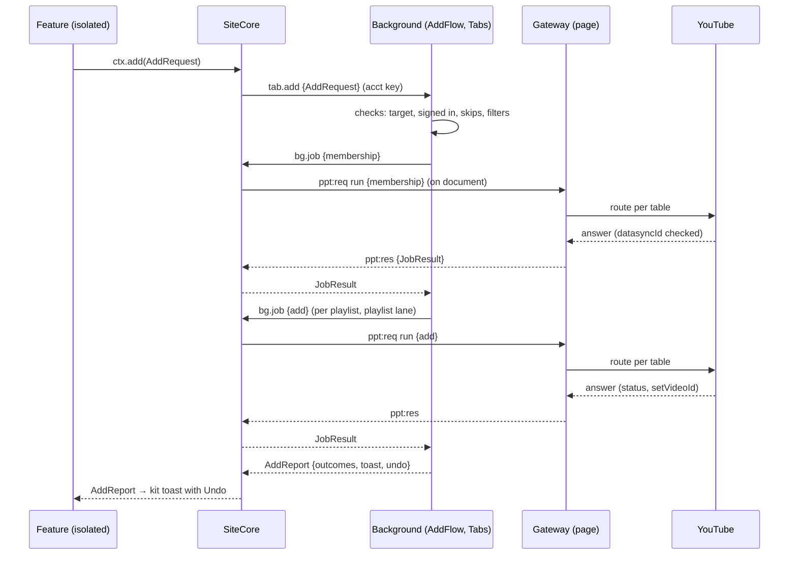

# 6. Architecture

This chapter says how 2.0 reaches YouTube and YouTube Music, what ships in each browser's manifest, and how the code is cut into modules, bundles and messages. It's assembled from tickets 01, 02, 10, 11, 16, 17, 21, 25, 28 and 29, the amendments that tickets 12, 14, 26 and 27 made to them, and ADR-0001, 0003, 0004, 0006, 0007, 0008 and 0010.

- **Testing, CI, size budgets and tooling** are in [07-quality.md](07-quality.md).
- **Release workflows, the manifest's copy and the permission prompts** are in [08-release.md](08-release.md).
- **Storage schema, migrations, sync and the private-write table** are in [04-features-accounts-data.md](04-features-accounts-data.md). This chapter gives only the store module's interface.

**How to read it:**
- **Requirement IDs.** Each ID is a testable statement:
  - `ARC-ACC-`: YouTube access;
  - `ARC-MAN-`: manifest, permissions, version floors and script registration;
  - `ARC-MOD-`: modules, bundles, store interface and folder layout;
  - `ARC-MSG-`: messaging;
  - `ARC-REG-`: the feature registry.
- **PROVISIONAL (X):** the rule holds until live check X has run signed in. [§6.2.15](#6215-live-checks-that-settle-the-provisional-rows) says what each result changes. A result edits the route table, which is data; the design stays the same.
- **Sites:** `www` is www.youtube.com and `music` is music.youtube.com. `Site = "www" | "music"`.
- **Signatures** are TypeScript and normative in shape. Payload field names that only one module reads may be refined when that module is built, as long as the shape holds.
- **Precedence:** where the tickets disagree, the later amendment or finding wins. What was resolved that way is listed in [§6.11](#611-resolved-by-precedence), and what's still open in [§6.12](#612-conflicts-found).
- **Resolutions:** decisions made while the spec was assembled are cited by R-number, from [resolutions.md](resolutions.md). A requirement that a resolution changed keeps its ID and ends with "(R-n)". The user's decisions of 2026-10-20 are R84–R99, the running-cost rules R100–R117, the GatherTube fold R120–R139, the icon R140, and the name R141–R144.
- **Names:** "the first-run page" is the extension page in `onboarding.html` that holds first run and the upgrade note (R37). Folder and file names keep `onboarding`.

## 6.1 Overview

```
 popup ─────┐  ui.* messages                ┌──────────── background (Chrome service worker / Firefox event page) ───────────┐
 settings ──┼──────────────────────────────▶│ Router ─┬─ Store ───────────── StorageAreas {local, session, sync}            │
 first-run  ┘  storage.local: read-only,    │         ├─ Registrar ───────── ScriptingPort · AccessPort · feature registry   │
               direct, for the first paint  │         ├─ Tabs ────────────── TabsPort   (tab registry, serving tab, account) │
                                            │         ├─ AddFlow ─────────── exec(job) through Tabs                          │
                                            │         ├─ Monitor · Badge ─── action                                          │
                                            │         └─ Playlists · Accounts · Diagnostics                                  │
                                            └──────────────────────────────────▲───┬───────────────────────────────────────────┘
                                                      tab.* (runtime.sendMessage) │   │ bg.* (tabs.sendMessage, frame 0)
 ┌─ a youtube.com tab ────────────────────────────────────────────────────────────┴───▼───────────────────────────────────────┐
 │ ISOLATED world, registration pp-www, injected in this order:                                                              │
 │   core-www.js      SiteCore: ExtLink · PageLink · TabView · FeatureHost · Scope · Items · Pointer · Keys                   │
 │   kit-www.js       Kit: Svelte runtime (linked exports) · shadow hosts · Toaster · Overlay · components · YouTube skin     │
 │   feature-*.js     one file per feature that is on: definePageFeature({ id, site, start(ctx) })                           │
 │   popovers.js      lazy, by scripting.executeScript: playlist picker + watch-page menu (own Svelte + Bits UI)             │
 │        ▲▼ PageChannel: CustomEvents with JSON-string detail; item jobs are dispatched on the item's element               │
 │ MAIN world, registration pp-www-page:                                                                                     │
 │   page-www.js      Gateway: route table · lanes · account guard · parsers · effect checks ── PagePort (live) ── YouTube    │
 └────────────────────────────────────────────────────────────────────────────────────────────────────────────────────────────┘
 A YouTube Music tab has the same shape: page-music.js, core-music.js, kit-music.js and its features.
```

**Runtime contexts:**

| Context | What runs there | Talks to YouTube? |
|---|---|---|
| **Background** (Chrome service worker, Firefox event page) | Store, Registrar, Tabs, AddFlow, Monitor and Badge, Playlists, Accounts, Diagnostics, Router | Never directly. Only through jobs sent to a tab. |
| **Page (MAIN) world** of a YouTube or YouTube Music tab | The gateway, and nothing else | Yes: it's the only sender |
| **Isolated world** of that tab | Site core, kit, features, popovers | Only through gateway jobs and streams |
| **Popup** | The toolbar popup (`ui/popup`) | Only through the background |
| **Extension pages** | Settings (`options_ui`) and the first-run page (`onboarding.html`: first run and the upgrade note) | Only through the background |

Two more targets exist only at build time: the live-check build ([§6.4.6](#646-live-check-build-and-tools)) and the CI watch tools ([07 §7.5](07-quality.md#75-breakage-detection)).

**Rules that shape everything below:**
- Every request to YouTube goes from an open YouTube tab's page world, as that tab's account (ADR-0001).
- Only the gateway runs in the page world (ADR-0007).
- Page code is WXT unlisted scripts, registered at runtime as two registrations per site, with one shared Svelte runtime (ADR-0008).
- Everything that spans tabs or writes storage runs in the background. Tabs only run jobs and draw.
- Messages are one-shot. There are no long-lived ports.

## 6.2 YouTube access

### 6.2.1 Where jobs run

- **ARC-ACC-01.** Every request to YouTube or YouTube Music is sent by the gateway, from the page (MAIN) world of an open, top-frame www or music tab. Nothing sends from the background, the popup, settings, the first-run page, an offscreen document or a frame. YouTube answers an extension origin with HTTP 403 (ticket 02).
- **ARC-ACC-02.** A youtube.com job runs in a www tab. A YouTube Music job runs in a music tab, the installed YouTube Music app's window included (PROVISIONAL, M4). YouTube Music's membership fallback is the one exception: it runs in a www tab.
- **ARC-ACC-03.** A job started inside a tab runs in that tab, as that tab's account. That covers in-page features, keys caught in the page and quick actions.
- **ARC-ACC-04.** A job started from the popup, settings or the first-run page runs in a **serving tab** ([§6.2.11](#6211-serving-tab-routing)). The one exception is Playing now, whose read and saves run in the YouTube Music tab ARC-ACC-68 picks, as that tab's account.
  - Writes travel popup → background → serving tab, and the result reaches the cache through the background.
  - If the popup closes mid-write, only the answer is lost, never the write.
- **ARC-ACC-05.** A job carries only what that job needs: a video ID, playlist IDs, a title, a channel input. Settings, channel filters and other accounts' data never enter the page, and nothing secret is sent into it.
- **ARC-ACC-06.** The gateway reads `ytcfg` values when the job runs and never caches them across page loads: the client name and version, visitor data, `SESSION_INDEX`, `DELEGATED_SESSION_ID`, `USER_SESSION_ID` and the experiment flags.
  - **Exception:** the tab's account (`LOGGED_IN` and `DATASYNC_ID`) is read once, at page load, and kept until the page reloads, just as YouTube's own page keeps it (ticket 11). The account guard compares against that value.
  - A stale client version (HTTP 400) can't happen, because nothing is ever sent outside a live page.
- **ARC-ACC-07.** No remote config, selectors or endpoint maps are ever fetched. Every route, parser, shape and fallback ships in the package (ADR-0005).
- **ARC-ACC-08.** 2.0 never clicks or otherwise drives YouTube's visible UI to do work. One exception: the right-click card menu opens YouTube's own ⋮ menu, because that is the feature.
- **ARC-ACC-09.** Until **consent** is given, no job runs and no extension script reaches a YouTube page. That includes the on-demand core (ADR-0010). `Tabs.serve` and `Registrar.ensure` refuse before consent.

### 6.2.2 Routes

A **route** is one way the gateway gets a job done.

| Route | What it is | Who builds and signs the request |
|---|---|---|
| **YouTube command** | Hand a command object to YouTube's global command resolver, found by shape ([§6.2.3](#623-the-command-resolver-found-by-shape)). The answer comes back through the `commandController`'s `onSuccess` / `onServerError`. | YouTube's code |
| **YouTube service request** | Fire YouTube's `yt-service-request` action with the endpoint, from a short-lived, invisible element under `ytd-app`. Read the answer from `yt-service-request-completed`, then remove the element. | YouTube's code |
| **YouTube Music handler** | `ytmusic-app`'s own machinery: `networkManager.fetch`, `handleServiceEndpoint`, `handleNavigationEndpoint`, `app.queue`, the ⋮ menu item's queue behaviour, and the queue panel's reorder drop. | YouTube Music's code |
| **Signed request** | The gateway's own same-origin `fetch` to `/youtubei/v1/<path>`, built and signed the way YouTube builds it ([§6.2.4](#624-auth-signing-and-the-cookie-rule)). www only. | The extension, in the page |
| **Plain request** | The same `fetch` with no `Authorization`, for public data | The extension, in the page |
| **Page read** | Read what the page already holds: `ytcfg`, the player response, YouTube's navigation events, the `<video>` element, `navigator.mediaSession`, renderer `data`, YouTube Music's state store. No request. | — |
| **YouTube's own UI** | The card menu opens YouTube's ⋮ menu (exempt, ARC-ACC-08) | — |

- **ARC-ACC-10.** A route qualifies for a job only if all three hold:
  1. it hands the full answer back to the gateway;
  2. it's quiet: YouTube shows nothing because of it, on success or on failure;
  3. it needs no click on YouTube's visible UI.

  Two visible changes are allowed, because each is the result the user asked for: the queue appearing or growing after Add to queue or Play next, and a like button's state changing after a like.
- **ARC-ACC-11.** Among the routes that qualify, YouTube's own come first (YouTube command, service request, YouTube Music handler), then the signed request.
- **ARC-ACC-12.** Each site's route table is one data constant, with one row per job listing its routes in order: `src/page/routes/www.ts` and `src/page/routes/music.ts`. Live-check results change only these constants.
- **Rejected routes:**
  - **Copying headers off YouTube's own requests** by wrapping `window.fetch`. It patches every YouTube page at `document_start` whether or not a feature needs it, it handles the same credential anyway, and it only works if YouTube has just made a signed-in request.
  - **Background requests with the `cookies` permission and a rewritten Origin.** Ticket 03 rules this out. It also sees only the default cookie store, so it's blind to containers and private windows.
  - **A hidden youtube.com frame** when no tab is open. See [§6.2.12](#6212-no-tab-not-signed-in-no-site-access).
  - **The YouTube Data API.** See [§6.2.14](#6214-no-data-api).

### 6.2.3 The command resolver, found by shape

The signed-out live check (ticket 25, 2026-10-19) found that YouTube's resolver has moved:
- no element on youtube.com has `resolveCommand` any more, so 1.5.0's `element.resolveCommand` lookup does nothing on today's YouTube;
- `ytd-app.handleCommandWithCommandHandler` passes no `commandController`;
- the working resolver is the global `default_kevlar_base.<key>.instance.resolveCommand`. Its key is minified (it was `O5`) and changes between builds. It calls `onSuccess` with the answer.

Requirements:
- **ARC-ACC-13.** The live www adapter finds the resolver by shape: an own property of `window.default_kevlar_base` whose `instance.resolveCommand` is a function. It never uses a fixed key, and never looks for `resolveCommand` on elements.
  - If several properties match, the first property whose `instance.resolveCommand` is a function is used, and a `resolver-ambiguous` breakage signal is recorded for diagnostics ([Q-WATCH-24](07-quality.md#757-runtime-breakage-signals)). (R34, R66)
- **ARC-ACC-14.** The page half starts at `document_start`, before YouTube's app exists. So the adapter looks the resolver up at first use, caches it for the life of the page, and looks again once if the cached one has gone. (R34)
  - If no property matches, the YouTube command route is unavailable for every job in that tab ([§6.2.9](#629-runtime-rules)).
  - A breakage signal is raised, and each job moves to its next route.
- **ARC-ACC-15.** A command is resolved as `resolveCommand(command, { commandController })`, where the controller carries `onSuccess(answer)` and `onServerError(error)`. L1 confirms that the options are forwarded.
  - Every command has a timeout. An HTTP 400 or 409 may reach neither callback: depending on a YouTube flag, it either resolves to nothing or reaches `onSuccess` with an `error` body (ticket 29's research).
  - Where an effect matters, such as a queue entry, it is confirmed from page state, never from the callbacks alone.
- **ARC-ACC-16.** The resolver's shape check is on the breakage watch list ([Q-WATCH-8](07-quality.md#752-the-watch-list)).
- **Where it's used:** `add` and `remove` (PROVISIONAL, L1), `queueAdd` and `queueUndo` (including `refreshPlaylistCommand`), and the card's `addToPlaylistCommand`.
- **Where the command comes from:** for item jobs, the gateway reads the command from the targeted card's own data. The card element is the job's target; it is never what resolves the command.

### 6.2.4 Auth signing and the cookie rule

**The signed request** (www only) copies YouTube's own InnerTube transport (ticket 01, §1 of its research):
- `POST https://www.youtube.com/youtubei/v1/<path>?prettyPrint=false` with `credentials: "same-origin"`. No API key.
- **Headers:**
  - `Content-Type: application/json`;
  - `X-Goog-Visitor-Id` (`VISITOR_DATA`);
  - `X-Youtube-Bootstrap-Logged-In` (`LOGGED_IN`);
  - `X-Youtube-Client-Name` and `X-Youtube-Client-Version` (`INNERTUBE_CONTEXT_CLIENT_NAME` and `…_VERSION`), always the page's own values, never hard-coded;
  - `X-Goog-AuthUser` (`SESSION_INDEX`);
  - `X-Origin` (`location.origin`);
  - `X-Goog-PageId` (`DELEGATED_SESSION_ID`), only when `ytcfg.EXPERIMENT_FLAGS.pageid_as_header_web` is on. Otherwise the context carries it as `context.user.onBehalfOfUser`, as YouTube's context builder does.
- **Body:** `context.client {hl, gl, clientName, clientVersion, configInfo, userAgent, …}`, `context.request.internalExperimentFlags`, and `context.user`, built the way YouTube's context builder builds them, plus the job's own fields.
- **`Authorization`:** up to three space-separated parts, computed the way YouTube computes them. Ticket 25 confirmed the construction matches yt-dlp's:
  - `SAPISIDHASH <ts>_<sha1>[_u]` from `SAPISID`, falling back to `__Secure-3PAPISID`;
  - `SAPISID1PHASH …` from `__Secure-1PAPISID`;
  - `SAPISID3PHASH …` from `__Secure-3PAPISID`;
  - each hash is `sha1("<USER_SESSION_ID> <ts> <cookie> <origin>")`, written `<ts>_<hex>_u`. When `USER_SESSION_ID` is absent, it's left out of the hash and the `_u` is dropped.

**The cookie rule:**
- **ARC-ACC-17.** The gateway reads `SAPISID`, `__Secure-1PAPISID` and `__Secure-3PAPISID` from `document.cookie`, through `PagePort.cookie`, only:
  - in a www.youtube.com tab's page world, where YouTube's own code reads the same values;
  - to sign a request for a job that no YouTube-built route qualifies for, or as a job's runtime fallback.
- **ARC-ACC-18.** A cookie value is used only to compute the `Authorization` header of that one same-origin request. It's never stored, logged, put into a breakage signal or diagnostics, passed to the isolated world, or sent anywhere else.
- **ARC-ACC-19.** The extension never:
  - requests the `cookies` permission;
  - reads cookies outside a YouTube page;
  - rewrites `Origin` or `Referer`;
  - strips security headers.
- **ARC-ACC-20.** If live check L3 shows that YouTube accepts same-origin requests carrying cookies alone, the signed request drops `Authorization`, and nothing reads cookies at all.

**Disclosure.** What's disclosed follows the final route table, decided at release (R48):
- **If a shipped route reads the session cookie** (expected: the signed request should ship, because create's YouTube command drops the new ID and the account-menu and Save-dialog reads open popups as commands, and it reads cookies unless L3 passes), the release keeps the four **cookie lines** of [08 §0](08-release.md#0-provisional-inputs): the first-run disclosure's cookie bullet ([REL-CON-12](08-release.md#41-the-disclosure)), the privacy policy's cookie bullet, Chrome's "Authentication information" tick ([REL-STORE-20](08-release.md#11-chrome-web-store-dashboard-answers)), and the signed route in the AMO reviewer notes ([REL-STORE-21](08-release.md#121-reviewer-notes-approval_notes)).
- **If no shipped route reads it**, either because L1 and L2 leave no job on the signed request or because L3 passes and the signed request sends no hash (ARC-ACC-20), the "Authentication information" tick and every cookie line in the consent text and the privacy policy are removed together. The reviewer notes describe the request as it ships (R49).

The copy is in [08-release.md](08-release.md). (R48)

### 6.2.5 Job catalogue

Jobs cover reads and writes alike. Each job runs through its site's route table ([§6.2.6](#626-route-table-youtubecom), [§6.2.7](#627-route-table-youtube-music)). The **lane** says how the gateway serialises it ([§6.2.9](#629-runtime-rules)).

| Job | Sites | Input | Result data | Lane | Needs signed in |
|---|---|---|---|---|---|
| `account` | www, music | — | `{ signedIn, datasyncId \| null }` (the raw ID; the core turns it into a key before anything leaves the tab) | none | no |
| `accountLabel` | www, music | — | `{ name, handle?, avatar? }` | playlist | yes |
| `membership` | www, music | `{ videoId }` | each playlist the account can add to: `{ id, title, privacy?, count?, contains }`, in the site's Save-dialog order. `count` is the song or video count, when the answer carries one; without it, YouTube Music's picker shows privacy only ([YM-PICK-4](03-youtube-music.md#10-the-playlist-picker); R73) | playlist | yes |
| `playlists` | www | — | each playlist: `{ id, title, privacy?, count?, thumb? }` | playlist | yes |
| `add` | www | `{ playlistId, videoId }` | `{ setVideoId }` | playlist | yes |
| `remove` | www | `{ playlistId, setVideoId }` | — | playlist | yes |
| `addBatch` | www | `{ playlistId, videoIds }`: up to 50 videos of a gather into the gather playlist, sent together after their membership reads ([YT-GT-18](02-youtube.md#2164-gathering-into-a-playlist); R126) | `{ results: { videoId, setVideoId?, failure? }[] }`, one per video, in order | playlist | yes |
| `removeBatch` | www | `{ playlistId, setVideoIds }`: up to 50 entries, a gather's Undo ([YT-GT-21](02-youtube.md#2164-gathering-into-a-playlist); R127) | `{ removed }` | playlist | yes |
| `save`, `unsave` | music | as `add`, `remove` | as `add`, `remove` | playlist | yes |
| `create` | www, music | `{ title, privacy, videoId? }`: with `videoId`, the playlist is created with that video already in it, in one request ([YT-NEW-01](02-youtube.md#27-creating-playlists), [YM-PICK-10](03-youtube-music.md#10-the-playlist-picker)) | `{ playlistId }` | playlist | yes |
| `channelOf` | www | `{ videoId }` | `{ channelId \| null, title?, handle? }` | none, or playlist when it falls back to a request | no |
| `resolveChannel` | www | `{ input }` (a typed handle, URL or ID) | `{ channelId, title, handle? }` | playlist | no |
| `videoInfo` | www | target, or the current video | `{ videoId, title, length, kind: "video" \| "short" }` | none | no |
| `queueAdd` | www | target card | `{ confirmed, quiet, undo?: { listId, setVideoId } }` | app-state | no |
| `queueUndo` | www | `{ listId, setVideoId }` | — | app-state | no |
| `queueAddList` | www | `{ videoIds }`: the rest of a gather into YouTube's queue, after the first video, which the tab the gather opened plays; at most 199 ([YT-GT-14](02-youtube.md#2163-destinations); R123) | `{ confirmed, count }` | app-state | no |
| `openCardMenu` | www | target card | — | none | no |
| `itemInfo` | music | target element | the item's menu endpoints (the library toggle with its state, the mix's watch endpoint and the artist and album browse endpoints included, R85), kind, like state, queue item ID, `selected`, header song count | none | no |
| `queueInsert` | music | `{ endpoint, position: "next" \| "end" }` | `{ ids }`: the new queue item IDs | app-state | no |
| `queueRemove` | music | `{ id }` | `{ index }` | app-state | no |
| `queueRemoveIds` | music | `{ ids }` | `{ removed }` | app-state | no |
| `queueMove` | music | `{ id, to: "next" \| "end" \| number }` | `{ from }` | app-state | no |
| `queueReinsert` | music | `{ videoId, index }` | `{ id }` | app-state | no |
| `like` | music | `{ endpoint }` (like or remove-like) | — | app-state | yes |
| `library` | music | `{ endpoint }`: the item's own library toggle, to save or remove (R85) | `{ inLibrary }` | app-state | yes |
| `navigate` | music | `{ endpoint }`: the item's own mix, artist or album endpoint (R85) | `{ navigated }`, true once the page or the queue has changed, within 10 s | app-state | no |
| `nowPlaying` | music | — | `{ videoId, title, artist, album?, artwork?, pos, len }`, or `null` when nothing is playing. `artwork` is the artwork's URL, for Playing now's art ([YM-POP-1](03-youtube-music.md#17-playing-now-in-the-popup)). (R8, R73) | none | no |
| `castState` | music | — | `{ casting }` | none | no |

**Streams** are continuous page reads, pushed to the isolated world while watched:

| Stream | Sites | What it carries |
|---|---|---|
| `player` | www | Ticket 07's readings on each `timeupdate` of `#movie_player` or `#shorts-player`: `{ at, videoId, pos, len, rate, playing, seeking, ad, player: "watch" \| "shorts", live flags }` |
| `nav` | www, music | Page type and current video, from YouTube's own navigation and player events |
| `nowPlaying` | music | As the job, on each change |
| `queue` | music | The queue's item IDs, in order, on each change |

### 6.2.6 Route table: youtube.com

The sending context is either **the tab** (where the action happened) or **a serving tab**. It's always the page world.

| Job | Primary route | Fallbacks, in order | Sending context | Decided by |
|---|---|---|---|---|
| `account` | **Page read:** `ytcfg` `LOGGED_IN` and `DATASYNC_ID`, at page load. Every answer's `responseContext.mainAppWebResponseContext.datasyncId` is then checked against it ([§6.2.10](#6210-the-account-check)). | — | The tab, or a serving tab. From the popup, an on-demand probe. | Settled; stability L7 |
| `accountLabel` | **PROVISIONAL (L2):** service request `account/account_menu` | Signed request `account/account_menu`. If neither works, the label is "Unnamed account". | Any tab of that account | L2 |
| `membership` | **PROVISIONAL (L2, L5):** service request `playlist/get_add_to_playlist {videoIds: [id], excludeWatchLater: false}`. Both answer shapes are parsed: the old renderer and the view model. | Signed request, same path | The tab, or a serving tab for the popup and settings | L2, L5 |
| `playlists` | **PROVISIONAL (L2, L5):** service request `browse {browseId: "FEplaylist_aggregation"}`. Watch Later (`WL`) is added as a fixed entry if it isn't listed. | Signed request. If the lockups carry no privacy, the privacy shown comes from the last membership read. | A serving tab | L2, L5 |
| `add` (auto-add, shortcuts, quick-save, picker; Watch Later and Shorts included) | **PROVISIONAL (L1):** YouTube command `playlistEditEndpoint {playlistId, actions: [{action: "ACTION_ADD_VIDEO", addedVideoId}]}`. Success is read from `status`, never from the HTTP code. | Service request, if L2 passes for `playlistEditEndpoint`; then signed request `browse/edit_playlist` | The tab; a serving tab for adds from the popup's picker | L1, L2, L6 |
| `remove` (undo, picker untick) | As `add`, with `ACTION_REMOVE_VIDEO` and the `setVideoId` the add returned | As `add` | The tab where the add ran, or the serving tab | L1, L6 |
| `addBatch` (Gather tabs into the gather playlist; R126) | **PROVISIONAL (L1, G1, G2):** as `add`, with one `ACTION_ADD_VIDEO` action per video in one `playlistEditEndpoint`. Each video's `setVideoId` or failure is read from the answer's per-action results; success is still read from `status` | As `add`: the service request, then the signed request `browse/edit_playlist` with the same actions | A serving tab ([ARC-ACC-73](#6216-gathering-tabs)) | L1, G1, G2 |
| `removeBatch` (a gather's Undo; R127) | **PROVISIONAL (G5):** as `remove`, with one `ACTION_REMOVE_VIDEO` per `setVideoId` in one request | As `remove` | A serving tab of that account | L1, G5 |
| `create` | **PROVISIONAL (L2):** service request `createPlaylistServiceEndpoint`. The YouTube command is excluded, because it drops the new ID. | Signed request `playlist/create`. With no tab: "Open YouTube to create playlists". | The tab, or a serving tab | L2 |
| `queueAdd` | YouTube command; see [§6.2.8](#6284-youtubes-queue-quiet-add-confirmation-and-undo). Works signed out. | None: nothing else reaches the queue. YouTube's ⋮ menu stays available. | The tab | L8, T29.Q1, T29.Q6–Q8 |
| `queueUndo` | YouTube command: the quiet removal ([§6.2.8](#6284-youtubes-queue-quiet-add-confirmation-and-undo)) | None: "Couldn't undo" | The tab | T29.Q2, T29.Q5–Q7 |
| `queueAddList` (Gather tabs into YouTube's queue; R123) | **PROVISIONAL (G3):** YouTube command `addToPlaylistCommand {listType: "PLAYLIST_EDIT_LIST_TYPE_QUEUE", …}` carrying every video ID, through the global resolver, in the watch tab the gather opened. `confirmed` once the queue panel's data ([ARC-ACC-35](#6284-youtubes-queue-quiet-add-confirmation-and-undo)) holds every ID sent. Works signed out. | None: the gather closes nothing and says so | The tab the gather opened ([ARC-ACC-75](#6216-gathering-tabs)) | G3 |
| `channelOf` (channel filters) | **Page read:** the `yt-navigate-finish` detail, else `#movie_player.getPlayerResponse()`. On Shorts, the navigation event's reel data. | Watch pages: plain request `next`. Shorts: plain request `reel/reel_item_watch`. | The tab | L9 |
| `resolveChannel` (typed channels) | **Plain request:** `navigation/resolve_url`, following up to 3 `urlEndpoint` hops and accepting only a `UC…` ID with `WEB_PAGE_TYPE_CHANNEL`. Then a plain `browse {browseId: "UC…"}` for the title and @handle. | With no tab, only `UC…` IDs and `/channel/UC…` URLs are accepted, parsed offline. Other forms show "Open YouTube to look up this channel". | A serving tab of any account, signed in or out | Settled |
| `videoInfo` | **Page read:** the navigation event and the player | — | The tab | L9 |
| `player` stream (watch progress) | **Page read:** the `<video>` inside `#movie_player` or `#shorts-player` | On Shorts, progress from the `<video>` alone if `#shorts-player`'s API is missing | The tab | L9 |
| `openCardMenu` | YouTube's own UI (exempt) | The browser's own menu | The tab | Settled |

### 6.2.7 Route table: YouTube Music

| Job | Primary route | Fallbacks, in order | Sending context | Decided by |
|---|---|---|---|---|
| `account` | **Page read:** `ytcfg` `LOGGED_IN` and `DATASYNC_ID`, at page load | — | The tab | L7 |
| `itemInfo` | **Page read** of the targeted renderer's `data`: the menu's endpoints by type (`queueAddEndpoint` by `queueInsertPosition`, `removeFromQueueEndpoint`, `addToPlaylistEndpoint`, `likeEndpoint`), the kind (`musicVideoType`, or the browse `pageType`), the top-level like, the queue item ID (`navigationEndpoint.watchEndpoint.index`), `selected`, and the header's song count. Menu items are matched by command type, never by position or label. | — | The tab | Proven signed out (ticket 27) |
| `queueInsert` (Play next, Add to queue; song, album, playlist) | **PROVISIONAL (M1):** the menu-item route ([§6.2.8.1](#6281-youtube-music-inserts)) | Queue replay | The tab | M1 |
| `queueRemove` (Remove from queue) | `app.queue.removeItem(itemId)`, which keeps the server's queue copy in step | None | The tab | M1 |
| `queueRemoveIds` (undo of an insert) | `app.queue.removeItem` for each inserted ID still waiting | None | The tab | M1 |
| `queueMove` (Play next and Add to queue on a queue item; undo of a move) | **PROVISIONAL (T28.1–T28.7):** the reorder drop ([§6.2.8.2](#6282-youtube-music-moves)) | None | The tab | T28.1–T28.7 |
| `queueReinsert` (undo of Remove from queue) | Queue replay of the song, then `queueMove` to its old index | None: Undo reports "Couldn't undo" | The tab | M1, T28 |
| `like` (like and unlike) | `app.handleServiceEndpoint({likeEndpoint})`. It's the only route, because YouTube attaches a bot check to each like. | None | The tab | M3 |
| `library` (Save to library and its undo; R85) | `app.handleServiceEndpoint(…)` with the endpoint the item carries: the toggle's `feedbackEndpoint` on tracks, or the card's `likeEndpoint` for a playlist or album. Tokens are never built. | None | The tab | M3 |
| `navigate` (Start mix, Go to album, Go to artist; R85) | `app.handleNavigationEndpoint(…)` with the endpoint the item carries: the mix's `watchEndpoint` or `watchPlaylistEndpoint`, or the `browseEndpoint` with the artist or album page type. In-app navigation, with no reload. Start mix replaces the queue, as YouTube Music's own item does, so it's a queue edit for casting (ARC-ACC-31). | None | The tab | Ticket 21 §2.6, §2.7 |
| `save`, `unsave` (and their undo) | **PROVISIONAL (M2):** `networkManager.fetch("/browse/edit_playlist")`. It's quiet and returns `status` and `setVideoId`. A duplicate rejection reads as *already in*. | None. Save isn't offered in a tab whose `networkManager` is missing. | The tab | M2 |
| `membership` (picker; the read before a save) | **PROVISIONAL (M2):** `networkManager.fetch("/playlist/get_add_to_playlist")` | **Membership only:** a www serving tab of the same account, in a window of the same kind. Else the picker shows no ticks, with ticket 12's note. | The tab | M2 |
| `create` | `networkManager.fetch("/playlist/create")`. YouTube Music's gated "feature enablement" answer counts as a failure. | — | The tab | M2 |
| `accountLabel` | `networkManager.fetch("/account/account_menu")` | "Unnamed account" | The tab | M2 |
| `nowPlaying` (job and stream) | **Page read:** `navigator.mediaSession.metadata` (title, artist, album, and the largest `artwork` entry's URL; R73) and the `<video>` element. The video ID comes from `#movie_player.getVideoData()`. Never the player bar, which an A/B test removes. | The queue's selected item (`app.queue`) | The tab | M1 |
| `castState` | **Page read:** `state.castStatus` in the app's state store, found signed out (ticket 25) | `#movie_player`'s API | The tab | M5 |

- **ARC-ACC-21.** On YouTube Music, `networkManager` signs requests itself. The signed request never runs on music.youtube.com. When an internal is missing there, the action is removed from that tab rather than falling back (`ctx.can(job)` is false), and its buttons hide in that tab. Its key stays caught, because a key never does nothing silently: each press answers "{Action} isn't working right now. The popup shows why." ([YM-KEY-12](03-youtube-music.md#12-keys-quick-action-shortcuts)). A feature with some actions unavailable is *partly working*, and its status detail names those actions (the Monitor, [§6.4.3](#643-background-srcbackground)). (R50, R68)
- **ARC-ACC-22.** Nothing YouTube Music runs on our behalf shows a second toast:
  - **Menu-item route:** the endpoint's toast `commands` are removed before it's handed over.
  - **Queue replay:** never runs the answer's `onResponseReceivedCommands`, except to store `queueContextParams`.
  - **Saves:** go through `networkManager.fetch`, which runs no response actions. `handlePlaylistEditEndpoint` is never used.
  - **Likes and Save to library:** if M3 shows YouTube Music's own toast, that toast stands in for ours on them (R85).
  - **If YouTube Music shows its own toast after one of our queue edits anyway,** the edit stands, a `quiet-route-noisy` breakage signal is recorded, and the feature that made the edit is *partly working* ([YM-FAIL-12](03-youtube-music.md#14-failures-and-breakage)). (R40)

### 6.2.8 Queue handling

#### 6.2.8.1 YouTube Music inserts

**Menu-item route** (primary, PROVISIONAL, M1):
1. Build a detached `ytmusic-menu-service-item-renderer`.
2. Hand its service-menu-item behaviour's `handleCommand` the item's `queueAddEndpoint`: `queueTarget` (`videoId`, or `playlistId` for albums, playlists and mixes, plus `onEmptyQueue`) and `queueInsertPosition` (`INSERT_AFTER_CURRENT_VIDEO` for Play next, `INSERT_AT_END` for Add to queue). The endpoint's toast `commands` are stripped first.

This matches YouTube Music exactly: the empty queue, the server-queue context, and the cast session if M1 shows that it forwards. Ticket 25 proved it works on a detached element, signed out.

**Queue replay** (fallback; page-internal, so it costs no disclosure):
1. `networkManager.fetch("/music/get_queue", { queueContextParams, queueInsertPosition, videoIds: [id] | playlistId })`, with the store's current `queueContextParams`.
2. Store the returned `queueContextParams`.
3. Dispatch `ADD_ITEMS { nextQueueItemId, index, items: queueDatas[].content, shouldAssignIds: true }`. The index is `getCurrentItemIndex() + 1` for Play next and `items.length` for Add to queue.
4. With an empty queue and a single target that has `onEmptyQueue`, call `handleNavigationEndpoint(onEmptyQueue)` instead.
5. Clear the responsive-radio flag, as YouTube Music's own insert does (ticket 28).

**Rules for both routes:**
- **ARC-ACC-23.** After any insert, the responsive-radio flag is off, matching YouTube Music.
- **ARC-ACC-24.** Success, and the IDs that undo needs, come from the queue itself, the same way on either route:
  1. Before the insert, record the item IDs from `app.queue.getItems()`. Each item's ID is `navigationEndpoint.watchEndpoint.index`, which `ADD_ITEMS` assigns.
  2. Afterwards, re-read until the queue has grown by the inserted block, within 10 s. An album or playlist goes in as one block.
  3. The new IDs are the undo handle. `queueRemoveIds` removes those still waiting.

  If the queue doesn't grow, the job has failed. Success is never assumed.
- **ARC-ACC-25.** Albums and playlists go in as one block, and their undo takes the whole block out again.

#### 6.2.8.2 YouTube Music moves

On a queue item, Play next moves the item to right after the playing song, and Add to queue moves it to the end. No second copy is made. Autoplay suggestions can't be moved, so they offer neither action (ticket 28, adopted into ticket 26).

- **Mechanism (PROVISIONAL, T28.1–T28.7):**
  - In the page world, the gateway builds a stand-in `dragEl`: an element whose `data` is the queue entry, placed among a stand-in parent's children at the target index.
  - It dispatches `new CustomEvent("ytmusic-reorderable-list-drop", { detail: { dragEl }, bubbles: true, composed: true })` on `ytmusic-player-queue#queue`.
  - YouTube Music's own handler then does the rest, in its own order: it moves the item in the store (`MOVE_ITEM`), sends `browse/edit_playlist ACTION_MOVE_VIDEO_AFTER` to the server's copy, forwards the move to a cast device, and clears the responsive-radio flag.
  - The event and `dragEl` must be built in the page world. A `CustomEvent` built in the isolated world would hide `detail` behind Firefox's Xray wrappers.
- **ARC-ACC-26.** Before firing, the gateway checks:
  - the entry is in `panel.data`;
  - `panel.data` is the store's current `queue.items` array;
  - the entry isn't the playing song.

  If any check fails, it doesn't fire. A stand-in that matches no entry makes YouTube Music move the *last* entry instead.
- **ARC-ACC-27.** After firing, the gateway confirms that the entry, found by its queue item ID (which a move doesn't change), sits at the target index. If it doesn't, the job fails.
  - The server step can't be confirmed per move: it's fire-and-forget, exactly as YouTube Music's own drag is.
- **ARC-ACC-28.** Undo moves the entry back to its old index by the same path. If the entry has started playing since, there's nothing to undo.
- **ARC-ACC-29.** At page load the live music adapter checks that:
  - `customElements.get("ytmusic-player-queue")` exists;
  - `panel.queue === app.queue`;
  - `Array.isArray(panel.data)`;
  - `typeof panel.onDrop === "function"`.

  If any fails, `queueMove` has no route, and every action that needs it is unavailable in that tab, as ARC-ACC-21 says. (R68)

#### 6.2.8.3 Queue jobs and casting

- **ARC-ACC-30.** Queue jobs run one at a time per tab, in the order they were triggered, in the app-state lane. That covers inserts, removes, moves, re-inserts and their undos, and likes.
- **ARC-ACC-31.** Casting is read from `state.castStatus`. While casting, every YouTube Music queue edit is unavailable, with one message ([YM-CAST-2](03-youtube-music.md#15-casting)): inserts, moves, Remove from queue, and their Undo. Save and Like still work. (R5)
  - There's no exception for inserts through the menu-item route, whatever M1 shows about forwarding to the cast device ([YM-CAST-3](03-youtube-music.md#15-casting)). Re-allowing them would need a new decision, not just a passing M1. (R46)
  - Firefox has no casting, so the rule never applies there.

#### 6.2.8.4 YouTube's queue: quiet add, confirmation and undo

YouTube's queue is a temporary server playlist (`TLPQ…`), owned by the session that created it, and mirrored by the tab's playlist panel data. Each entry has its own `playlistSetVideoId`, so a video can be queued twice. A `setVideoId` is unique only within its own `TLPQ…` list, so it's always paired with that list's ID.

- **ARC-ACC-32. First add** (no queue yet): the card's own `addToPlaylistCommand {listType: "PLAYLIST_EDIT_LIST_TYPE_QUEUE", …}`, the command 1.5.0 sends, resolved through the global resolver. The first add is quiet, because the create answer carries no toast.
- **ARC-ACC-33. Later adds** (a `TLPQ…` queue exists; PROVISIONAL, T29.Q1, T29.Q8):
  - resolve `playlistEditEndpoint {playlistId: "TLPQ…", actions: [{action: "ACTION_ADD_VIDEO", addedVideoId}], params: "IAE%3D"}`;
  - its answer carries only `refreshPlaylistCommand`, and `onSuccess` gets `STATUS_SUCCEEDED` with the new entry's `setVideoId`;
  - 1.5.0's command, used here, would make YouTube show its own "Added to Queue" toast for every add after the first.
- **ARC-ACC-34. When the quiet value stops working:** if YouTube shows its own toast after a quiet queue edit (an add or its Undo), the edit stands. That's seen when the answer carries YouTube's toast action despite `IAE%3D`, or when YouTube's toast appears. Our own toast for an add is suppressed, so only one toast shows. A `quiet-route-noisy` breakage signal is recorded, and it marks the queue button *partly working* (tickets 12 and 18; [YT-Q-05](02-youtube.md#210-the-thumbnail-add-to-queue-button)). (R40)
- **ARC-ACC-35. Confirmation** (PROVISIONAL, L8, T29.Q7):
  - **Where it reads:** the queue panel's data: `ytd-playlist-panel-renderer`'s `.data`, `.polymerController.data` or `.inst.data`, whichever carries a `playlistId` starting `TLPQ`.
  - **What it looks for:** the entry with our `videoId` whose `playlistSetVideoId` wasn't in the panel before our add. Comparing the before and after sets copes with duplicates.
  - **Budget:** 2 s.
  - **First add:** if the panel can't be read, the miniplayer turning active is the fallback signal.
  - **No signal:** the result is `confirmed: false`, which the queue button shows as *Sent, not confirmed*, never as success ([YT-Q-06](02-youtube.md#210-the-thumbnail-add-to-queue-button)). Add to queue isn't an add ([YT-Q-03](02-youtube.md#210-the-thumbnail-add-to-queue-button)): `queueAdd` runs in the tab and never goes through the add flow.
- **ARC-ACC-36. Undo** (PROVISIONAL, T29.Q2, T29.Q5–Q7):
  1. Wait until the entry has its `playlistSetVideoId`, which shows the add's own edit has finished. T29.Q6 sets the wait.
  2. Resolve `playlistEditEndpoint {playlistId: "TLPQ…", actions: [{action: "ACTION_REMOVE_VIDEO", setVideoId}], params: "IAE%3D"}` with no `clientActions`.
  3. Resolve `refreshPlaylistCommand {listId}`.
  4. Confirm that the `setVideoId` is gone from the panel data. If it isn't, retry once, queued behind any edit YouTube has in flight; the likely cause is an HTTP 409 from overlapping edits. If it's still there, report "Couldn't undo".

  The result comes from the refreshed panel, never from the callbacks.
- **ARC-ACC-37.** The gateway never removes a queue entry by video ID, which removes every copy. It never uses the panel's own remove item or `playlistRemoveVideosAction`; both make YouTube show "Removed from Queue".
- **ARC-ACC-38.** YouTube queue edits run in the app-state lane, so our own edits never overlap.

### 6.2.9 Runtime rules

- **ARC-ACC-39. Route unavailable vs. job failed.**
  - **Route unavailable:** the hook is missing, it throws before sending, or no answer arrives within the budget. The gateway moves to the job's next route and raises a breakage signal.
  - **Job failed:** YouTube answered: `STATUS_FAILED`, HTTP 4xx or 5xx, signed out, or a different account. The failure is reported as it is, and no second route is tried.
  - When every route is unavailable, the job answers `unavailable`.
- **ARC-ACC-40. Writes never run twice.** A write falls back only when the first route provably sent nothing: the hook was missing, or it threw synchronously. A write that may have been sent but whose answer was lost is reported as failed or unconfirmed, and never retried. Reads may fall back on a timeout.
- **ARC-ACC-41. Success is read from the answer** (`status` and the expected fields), never from the HTTP code. `edit_playlist` reports a failure as HTTP 200 with `STATUS_FAILED`.
- **ARC-ACC-42. Two lanes per tab.** Each runs one job at a time, in order:
  - **app-state lane:** jobs that change YouTube's own state in the tab: queue edits on both sites, and likes;
  - **playlist lane:** playlist reads and writes, and every other job that sends a request.

  Page reads skip the lanes. A job that falls back from a page read to a request joins the playlist lane for that request. So a picker read never waits behind a 10 s queue check.
- **ARC-ACC-43. Human scale** (ticket 03):
  - one request per user intent;
  - nothing crawls: a playlist list refreshes only on ↻ "Refresh playlists", by itself when it's opened and its cache is older than 5 minutes, and from every membership read, which an add or a picker open makes anyway ([UI-PICK-25](05-ui.md#contents-and-behaviour-every-container), [DATA-20, DATA-21](04-features-accounts-data.md#45-caches-and-expiry)) (R39);
  - on HTTP 429, the add flow pauses that account for 60 s.
- **ARC-ACC-44. Timeouts:** pings 2 s, jobs 10 s, the YouTube queue confirmation 2 s, and the YouTube Music queue growth check 10 s.
- **ARC-ACC-45. The page world logs nothing.** No `console` call exists under `src/page/`.
- **ARC-ACC-71. Streams cost nothing without a watcher.** The gateway's streams (`nav`, `player`, `nowPlaying`, `queue`) attach to the page's own events only while something watches them, and detach when the last watcher goes. They never use a timer. The `player` stream emits only for the counting player (`movie_player` or `shorts-player`), and only while auto-add's tracker watches it ([YT-AA-44](02-youtube.md#2312-what-tracking-costs)). (R106, R114)

### 6.2.10 The account check

An **account** is whatever `ytcfg.DATASYNC_ID` identifies: a Google account or one of its brand accounts (ADR-0003).
- A page is **signed in** when `ytcfg.LOGGED_IN` is true.
- A signed-out page's `DATASYNC_ID` (`V…||`) is a visitor ID. It never becomes a key.
- The ID is used whole and never parsed. It's never stored ([ACC-03](04-features-accounts-data.md#21-what-an-account-is)); only its account key is.

**Requirements:**
- **ARC-ACC-46. The raw `DATASYNC_ID` never leaves its tab.** The isolated core's PageLink turns it into the **account key**: the first 16 characters of the base64url SHA-256 of the whole ID. Only that key crosses to the background. The gateway works with the raw ID inside the page and never stores it.
- **ARC-ACC-47. The account guard** applies in three places:
  1. **Before a job:** the core forwards a job that names an account only if the job's account key equals the tab's account key. Otherwise it answers `accountChanged` without sending anything.
  2. **Before every write:** every add, save, undo and picker untick starts with a `membership` read, which must answer for the same account. This read doubles as the account check (ticket 12).
  3. **After every answer:** the gateway compares `responseContext.mainAppWebResponseContext.datasyncId` with the page-load `DATASYNC_ID`. On the first mismatch it trips: it answers `accountChanged`, and refuses every account job in that tab until reload. The core then disarms auto-add there, and the tab shows ticket 11's "Your YouTube account changed in another tab. Reload this page to keep saving here." Every explicit press answers with it; for auto-add it shows once per tab. (R55)

  Watch Later is why this matters: its ID means "the current account's Watch Later", so a stale tab would save into the wrong account.
- **ARC-ACC-48.** YouTube Music likes return nothing the gateway can read. They rely on the tab having already tripped on an earlier answer; there's no extra read per like.
  - **PROVISIONAL (M2):** if YouTube Music's answers carry no `datasyncId`, the YouTube Music guard has only the page-load `ytcfg` check.
- **ARC-ACC-49.** The background accepts `tab.add` only when its account key matches the tab registry's entry for that tab.
- **ARC-ACC-50.** If `ytcfg`'s identity keys are missing, every job that needs an account answers `unavailable`, and the features that depend on an account stop instead of acting on an unknown account.
- **ARC-ACC-51.** 2.0 never switches accounts. It only links to YouTube's own pages: `https://www.youtube.com/channel_switcher` for Switch account, and YouTube's sign-in page.
- **PROVISIONAL (L7):** this assumes `DATASYNC_ID` survives sign-out and sign-in, and is the same in every browser and on both sites. If it doesn't, setups are re-attached by playlist ownership (ADR-0003).

### 6.2.11 Serving-tab routing

A job started from the popup, settings or the first-run page runs in a **serving tab**: a YouTube or YouTube Music tab that is signed in to the account the job is for. `Tabs.serve` chooses it.



- **ARC-ACC-52. Account in view,** in [ACC-13](04-features-accounts-data.md#23-which-account-is-shown)'s order:
  1. the active tab's account, or its signed-out state, when the popup sits over a YouTube or YouTube Music tab;
  2. else the account of the most recently active YouTube or YouTube Music tab, in a window of the same kind;
  3. else, in a normal window, the last account **with a setup** that was current in a normal window (`Device.lastAccount`), from cache. A private window has no such fallback.

  Settings uses the account picked in it ([ACC-14](04-features-accounts-data.md#23-which-account-is-shown)). (R54)
- **ARC-ACC-53. Candidates** come from `tabs.query({ url: [...the job's site pattern], discarded: false })`. Host access is enough for the `url` filter and for the `url`, `incognito` and `lastAccessed` fields, so no `tabs` permission is needed.
  - **Site:** youtube.com jobs use www tabs. YouTube Music jobs use music tabs, the installed app's included. YouTube Music's membership fallback uses a www tab.
  - **Window kind:** a normal window's popup or settings never uses a private tab, and a private window's popup uses only private tabs.
  - **Skipped:** frozen tabs, where the browser reports them (`Tab.frozen`, Chrome 132+), and discarded tabs, up front without a ping.
  - **Containers** are ignored, because the account decides.
- **ARC-ACC-54. Order:**
  1. the requester's active tab, if it's a candidate;
  2. tabs known to be on the account in view, most recently accessed first (`lastAccessed`);
  3. tabs whose account is unknown, most recently accessed first.
- **ARC-ACC-55. Ping** each candidate in turn (`bg.ping`), with a 2 s budget that includes injecting the site core when it's missing. A tab is used only if:
  - it answers;
  - its account key is the account in view. Account-free jobs, such as `resolveChannel`, take any tab, signed in or out;
  - it's signed in, when the job needs that.

  On a timeout or a mismatch, the next candidate is tried.
- **ARC-ACC-56.** Routing never wakes, reloads, activates or undiscards a tab.
- **ARC-ACC-57. The tab registry** (each tab's site, account key, signed-in state and whether it's private, and from `tab.hello` whether its page started hidden on a first load, with when it said so, for automatic gathering's second trigger) is filled from two sources: `tab.hello` from site cores (with `sender.tab.incognito`), and on-demand pings. Recency comes from `lastAccessed`, never from tracking events. (R133)
- **ARC-ACC-68. Picking a YouTube Music tab for a job that names no tab.** The popup's Playing now row is one caller ([YM-POP-11](03-youtube-music.md#17-playing-now-in-the-popup)); keys from any tab are the other (ARC-ACC-69; R88). It reads:
  1. the focused window's active tab, if it's YouTube Music;
  2. else the audible YouTube Music tab (`tab.audible`);
  3. else the most recently accessed one (`lastAccessed`).

  Candidates are filtered by window kind as in ARC-ACC-53. The row is read with the `nowPlaying` job in that tab, through the on-demand probe when the tab has no core ([ARC-MAN-15](#633-runtime-script-registration)), so it works whichever YouTube Music features are on. It's shown only while the section switch is on and YouTube Music has site access, and hidden when `nowPlaying` answers `null`. Ticket 10's order was kept for this alone after ADR-0004 removed its first caller, a browser-level quick-action key; keys from any tab bring that caller back (ADR-0004's 2026-10-20 amendment). (R8, R33, R88)

  **Playing now's saves run in that same tab, as that tab's account** ([YM-POP-2](03-youtube-music.md#17-playing-now-in-the-popup), [YM-POP-5](03-youtube-music.md#17-playing-now-in-the-popup)). `ui.playingNow` answers with the tab it read, and the row's Save, its ▾ picker's reads and adds, and their Undo name that tab. The background runs them there with `Tabs.runIn`, after checking that the tab's account key is still the one the row was read with. They never go through `Tabs.serve` or the account in view (ARC-ACC-52). If that tab has closed or its account has changed, the save is never sent to another tab: it fails, or answers with the account guard's message (ARC-ACC-47).
- **ARC-ACC-69. Keys from any tab and the browser menu** (R88, R91). Both start in the background, and both run their job with `Tabs.runIn` in one tab, as that tab's account, never through `Tabs.serve` or the account in view.
  - **A command** (`commands.onCommand`) picks its tab by ARC-ACC-68's order: for the two YouTube Music commands among YouTube Music tabs, and for Watch later among www tabs whose current video is known (`videoInfo`), with the focused window's kind. Discarded tabs are skipped, and no tab is woken, reloaded, activated or undiscarded (ARC-ACC-56). With no candidate, nothing runs, and the Badge shows the 3 s ✕ ([YT-ANY-06](02-youtube.md#214-keys-from-any-tab)).
  - **A menu click** (`contextMenus.onClicked`) runs in the tab it came from, on the link's video ID (from `linkUrl`), else the tab's current video.
  - **Before the job,** `Registrar.ensure(tabId, { core: true, kit: true })` injects whatever that tab is missing (ARC-MAN-15), so the toast can show there. The job then runs as any in-tab add does (`AddFlow.add` with `Tabs.runIn`), or as YouTube Music's `like` with its Undo.
  - **The answer** goes to the tab as its usual toast, held while the tab is hidden, and for a command also to the Badge as a 3 s ✓ or ✕ with the answer's text as the title.
  - **While the feature is off, held or waiting for consent,** the handler returns at once: it reads, injects and answers nothing (FT-59).

- **ARC-ACC-70. The tab registry and pings stay small** ([ADR-0012](../../../docs/adr/0012-automatic-work-is-event-driven-scoped-and-paced.md)):
  - a site core sends `tab.hello` once per page load, never per in-app navigation;
  - the registry holds at most 200 tabs. A `tab.hello` replaces the tab's entry, and an entry goes when a send or ping finds its tab gone, or when it's the oldest beyond 200. No tab event is needed for this;
  - a job pings at most 3 candidates (ARC-ACC-55), then answers `NoTab`;
  - a job injects the site core into at most one tab. (R110)

### 6.2.12 No tab; not signed in; no site access

- **ARC-ACC-58. No YouTube tab** (no candidate is left):
  - **What shows:** the popup and settings show the account's cached data, stamped with when it was fetched, plus an **Open YouTube** button (**Open YouTube Music** in the YouTube Music section). The button opens `https://www.youtube.com/` or `https://music.youtube.com/` in a new tab, which needs no `tabs` permission.
  - **Settings stays open** and refreshes when a tab of the account in view answers.
  - **Copy:** the stamp, the banners and their wording are [UI-POP-10](05-ui.md#banners) row 7, [UI-POP-27](05-ui.md#overlays-and-states) and [FT-54](04-features-accounts-data.md#17-site-access-and-youtube-tabs).
  - **What needs a tab** ([FT-54](04-features-accounts-data.md#17-site-access-and-youtube-tabs)): the picker and ↻ Refresh playlists, creating a playlist, typed handles (other than `UC…` IDs and `/channel/UC…` URLs), every quick action, This video, Playing now, and Diagnostics' **Check now**, which is disabled with "Open YouTube to check" and a button ([HEALTH-23](04-features-accounts-data.md#55-diagnostics-check-now-and-the-report)). Everything else works from cache. (R15, R39)
- **ARC-ACC-59.** There's no hidden frame and no offscreen document.
  - **Why:** a hidden frame sees only the default cookie store, so it's the wrong account for container and private users. It also loads YouTube's embed client on each wake-up, needs a second code path, and is unproven.
  - **Reversible:** it could be added in a 2.x with no new prompt, because `offscreen` carries no warning.
- **ARC-ACC-60. Not signed in** (`LOGGED_IN` false):
  - jobs that need an account aren't sent; the gateway answers `signedOut`;
  - Add to queue, the card menu and YouTube Music's queue actions keep working;
  - what users see: auto-add stays silent, with no toast, and every explicit action that needs a signed-in account shows a failure toast with a **Sign in** action ([YT-GEN-08](02-youtube.md#21-rules-shared-by-every-youtube-feature), [YM-ACC-5](03-youtube-music.md#2-accounts-and-private-windows)). (R3, R41)
- **ARC-ACC-61. No site access** (revoked on Firefox, Firefox 125–126 installs, Chrome's "on click" or a withheld site):
  - **Check:** the background calls `permissions.contains` per site on every start, and on `permissions.onAdded` and `onRemoved`.
  - **Missing:** a toolbar "!" on every tab, plus a button in the popup and settings that asks for access ([FT-13](04-features-accounts-data.md#12-switching-features), [§1.7](04-features-accounts-data.md#17-site-access-and-youtube-tabs) for the copy). The click handler calls `permissions.request` first and synchronously, before anything else. (R53)
    - **Every tab,** because without host access the extension can't tell which tabs are that site's.
    - **YouTube Music:** missing access raises the "!" only while something that needs it is on: a YouTube Music feature, or "Also on YouTube Music" while Playlist shortcuts is on, with the YouTube Music section switch on ([FT-47](04-features-accounts-data.md#17-site-access-and-youtube-tabs)). That includes what first run's Agree saved on but held after a refused prompt (below).
  - **Features:** a feature that's on for a site without access shows as on but held with "Needs site access", and nothing is registered or injected for it until access is granted.
  - **Refused at first run's Agree (Chrome):** consent and the other ticks still apply. The ticked YouTube Music features are saved on but held in the same way, and so is Playlist shortcuts' "Also on YouTube Music", while Playlist shortcuts runs on YouTube. **Give access** shows in the popup and settings ([FT-40](04-features-accounts-data.md#16-first-run) step 2). (R14, R53)
  - **Refused from a switch** in the popup or settings: the YouTube Music feature's switch, or "Also on YouTube Music", stays off ([FT-52](04-features-accounts-data.md#17-site-access-and-youtube-tabs)). The exception is the click that first switches Playlist shortcuts on: Playlist shortcuts goes on, "Also on YouTube Music" is written off in the same change, and "No access to YouTube Music, so shortcuts work on YouTube only." shows in place, under Playlist shortcuts' row. (R71)
  - **Chrome 133+, PROVISIONAL** ([ticket 09](../issues/09-where-things-live.md), at build; [FT-53](04-features-accounts-data.md#17-site-access-and-youtube-tabs)): while a feature for that site is on and access is missing, the registrar also calls `permissions.addHostAccessRequest` on open tabs of that site.

### 6.2.13 Private windows

- **ARC-ACC-62.** The manifest leaves `incognito` at its default. 2.0 runs in private and incognito windows only if the user allows it in the browser, which is off by default on both.
- **ARC-ACC-63.** When it is allowed, a private tab gets its tab view as usual: an account that already has a setup works as in a normal window.
- **ARC-ACC-64.** Nothing from a private session is ever persisted:
  - the store refuses such writes ([§6.9](#69-the-store-module-interface); the table is [04 §4.7](04-features-accounts-data.md#47-the-private-window-write-guard)). Shared-settings changes made in a private window are saved, because they carry nothing about the window's browsing ([DATA-32](04-features-accounts-data.md#47-the-private-window-write-guard); R58, R83);
  - a private tab's registry entry, breakage signals, session skips, watch progress and the rest of [DATA-33](04-features-accounts-data.md#47-the-private-window-write-guard)'s list live in memory only: the tab's own, or the background's variables, never `storage.session`;
  - fetched playlist lists, membership and undo entries live only in that tab's memory.
- **ARC-ACC-65.** Origin is computed by the background from the sender. The one value a message supplies, the popup's window ID, is checked against the sender before it's used:
  - **content scripts and the settings tab:** `sender.tab.incognito`;
  - **the popup:** it has no `sender.tab`, so it sends its window ID (ARC-MSG-06). The background accepts it only when the sender is the popup's own page (`sender.url` is the popup's, and there's no `sender.tab`); from any other sender the message is refused. It then reads `windows.get(id).incognito`. A window that can't be found counts as private.
  - `extension.inIncognitoContext` isn't used, because it's false in Chrome's spanning-mode incognito popup.
- **ARC-ACC-66.** Routing never mixes window kinds (ARC-ACC-53).

### 6.2.14 No Data API

- **ARC-ACC-67.** 2.0 never calls the YouTube Data API, not even as a fallback, and not on the user's own credentials.
  - Every job has a session route (ticket 01).
  - YouTube's API policies (§III.D, §III.E) forbid an API client that also uses undocumented YouTube APIs.
  - No `googleapis.com` or `accounts.google.com` host and no `identity` permission ship.
- If YouTube ever closes the session route altogether, 2.0 needs a new decision, not a fallback.

### 6.2.15 Live checks that settle the PROVISIONAL rows

**Status:** ticket 25's probe (branch `task/live-checks`, `probes/live-checks/`) passed its signed-out validation on 2026-10-19 in headless Chrome for Testing 155. The signed-in reports from Chrome and Firefox are still outstanding.

What the signed-out run found:
- the resolver moved ([§6.2.3](#623-the-command-resolver-found-by-shape));
- ticket 29's quiet removal and quiet add work through the global resolver, and 1.5.0's command shows YouTube's "Added to Queue" for later adds;
- YouTube Music's menu-item route works on a detached element;
- `state.castStatus` holds the cast state;
- `get_queue` returned 200 items of a 500-song radio;
- the auth hash matches yt-dlp's construction.

| Check | What it tests | If it passes | If it fails |
|---|---|---|---|
| **L1** | The resolver with `playlistEditEndpoint` and a `commandController`: options forwarded, `onSuccess` / `onServerError` get the answer, and nothing shows on success *or* on failure (a full or deleted playlist) | `add` and `remove` use the YouTube command | `add` and `remove` use the service request if L2 passes for `playlistEditEndpoint`, else the signed request |
| **L2** | `yt-service-request` from a temporary element under `ytd-app` returns the answer with no popup, toast or navigation. Run once each for `get_add_to_playlist`, `FEplaylist_aggregation`, `createPlaylistServiceEndpoint`, `account/account_menu` and `playlistEditEndpoint`. | That job uses the service request | That job uses the signed request |
| **L3** | A same-origin request with cookies and no `Authorization` gets a signed-in answer and can write | The signed request sends no hash, nothing reads cookies, and the "Authentication information" tick and the cookie lines go (R48) | The signed request computes the hash |
| **L4** | `SAPISID` (or `__Secure-3PAPISID`) is readable from `document.cookie` while signed in; the hash is checked against `Origin` / `X-Origin` | The signed request works as specified | The signed request can't exist. Jobs left without a qualifying route are unavailable, and each gap becomes a new ticket. Not expected. |
| **L5** | The shapes of `get_add_to_playlist` (renderer or view model, paging, privacy, Watch Later) and of the `FEplaylist_aggregation` lockups | Parsers fixed to those shapes | — (shape detail) |
| **L6** | A duplicate add on www; `ACTION_REMOVE_VIDEO` by `setVideoId` removes one entry; the full-playlist error | [02-youtube.md](02-youtube.md)'s duplicate rules apply as written | Its PROVISIONAL rule for unattended adds applies ([YT-ADD-07](02-youtube.md#251-order-and-membership)) |
| **L7** | `DATASYNC_ID` stability, and the presence of `responseContext…datasyncId` | The account guard as specified | Setups are re-attached by playlist ownership |
| **L8** | After a queue add on an existing queue, the video shows in the panel data, and which field holds it | Confirmation reads that field | Only the fallback signal remains, and Add to queue on an open queue shows *Sent, not confirmed* ([YT-Q-06](02-youtube.md#210-the-thumbnail-add-to-queue-button)) |
| **L9** | `#shorts-player`'s player API, and `yt-navigate-finish` on every swipe | Page reads as specified | The Shorts channel comes from a plain request, and progress from the `<video>` alone |
| **M1** | The menu-item route queues correctly and shows nothing once `commands` are stripped; queue replay works signed in | Menu-item route primary, replay as fallback | Replay is primary. Either way, queue edits are unavailable while casting (ARC-ACC-31; R5, R46). |
| **M2** | `networkManager.fetch` returns signed answers for `get_add_to_playlist`, `browse/edit_playlist`, `playlist/create` and `account/account_menu`; membership (`containsSelectedVideos`) is present; answers carry `datasyncId` | Membership is read on YouTube Music | Membership comes from a www serving tab, else there are no ticks. Without `datasyncId`, the YouTube Music guard uses only the page-load `ytcfg`. |
| **M3** | A like through `handleServiceEndpoint` sticks, repaints the like button and shows no toast. The same for Save to library, signed in, with the item's own endpoint (R85) | As specified | YouTube Music's own toast stands in for ours on likes, and on Save to library |
| **M4** | In the installed YouTube Music app (Chrome, Edge), `tabs.query` finds its tab, `executeScript` and registered scripts run there, and the popup's active tab is the app's. A key from any tab, set in the browser, reaches the background while the app window has focus (R33, R88). | The app is first-class | The app gets only what reaches it, and the gap is recorded |
| **M5** | Where an active cast session shows: `state.castStatus` (found signed out), or `#movie_player`'s API | Casting is detected, and every queue edit and its Undo, inserts included, is unavailable while casting (ARC-ACC-31; R46) | Casting can't be detected, so every queue edit (inserts, moves, Remove from queue and their Undo) stays available, and their toasts say "this tab's queue" instead of "the queue" ([YM-CAST-2](03-youtube-music.md#15-casting)). Wherever casting can be read, R46 still holds. |
| **P1** (settled from source, R83) | A glance at the real dialogs: the install prompts for the final manifest, no prompt on the 1.4.5 → 2.0 Firefox update, and Chrome's prompt for YouTube Music access. The strings are already settled: Firefox's from its own string files, code and support articles, and Chrome's from Chromium's source ([R83](resolutions.md#after-the-spec-firefox-prompts-and-data-collection-r83)). | [08 §5](08-release.md#5-permission-prompts-by-audience)'s copy stands | 08 §5 adjusts its copy to the real dialog |
| **P2** | Registered scripts apply at browser start before the background runs (`persistAcrossSessions`). That registrations are restored after an update is already answered from browser source. | As specified | The reconcile also listens for `runtime.onStartup` and injects into tabs already open |
| **T28.1–T28.7** | Signed-in queue entries carry `playlistEditParams`, `playlistSetVideoId` and the queue's `playlistId`; the drop moves the entry and the server order follows; radio survives; panel states (before anything plays, Lyrics or Related showing); casting | `queueMove` as specified | No moves: queue items keep no Play next / Add to queue, and Remove's undo has no route |
| **T29.Q1–Q8** | YouTube's toast on later adds (Q1); quiet and plain removal (Q2, Q3); the panel's own remove item (Q4); after-effects (Q5); undo timing and HTTP 409 (Q6); where the panel data lives (Q7); the quiet add (Q8) | Quiet add, confirmation and Undo as specified | The queue button keeps no Undo. If only the quiet add fails, ARC-ACC-34 applies. |
| **G1** (R126) | `edit_playlist` with 2, 50 and 200 `ACTION_ADD_VIDEO` actions in one request: accepted, order kept, a `setVideoId` for each | `addBatch` sends up to 50 per request | Batches shrink to the largest size that passes, down to one video per request |
| **G2** (R126) | The same request with one video already in the playlist: refused, or a copy added, and whether the rest still go in | As specified | Nothing changes: a batch never holds a video its membership read found in the playlist ([YT-GT-18](02-youtube.md#2164-gathering-into-a-playlist)) |
| **G3** (R123) | YouTube's queue built with one `addToPlaylistCommand` carrying a list, signed in, from a fresh watch tab: every video present, in order, and how many it takes (100 passed signed out) | `queueAddList` as specified, up to 200 a gather | YouTube's queue takes as many as pass; a gather over that count sends that many and keeps the rest of its tabs open ([YT-GT-14](02-youtube.md#2163-destinations)) |
| **G4** (R123) | `watch_videos` signed in: still capped at 50, and nothing written to the account | As specified | Recorded; the design doesn't change |
| **G5** (R127) | `edit_playlist` with several `ACTION_REMOVE_VIDEO` actions by `setVideoId` in one request | `removeBatch` as specified | Undo removes one entry per request |
| **G6** (R129, R130) | In Chrome and Firefox: how a tab opened in the background (middle-click, "Open all"), a tab restored at browser start, one reopened with Ctrl+Shift+T and a hidden tab that reloads report their start visibility, navigation type and `lastAccessed`; and whether `lastAccessed` survives a restart | Triggers 1 and 2 as specified ([YT-GT-23, YT-GT-24](02-youtube.md#2165-automatic-gathering)) | If restored tabs look opened in the background, trigger 2 also ignores any tab whose `lastAccessed` is more than 10 s older than its page's start. If `lastAccessed` doesn't survive a restart, trigger 1 counts from the restart |
| **G7** (R127) | Reopening tabs for a gather's Undo: Firefox's `tabs.create` with `discarded: true` and `title`; what Chrome does with several tabs created in the background at once | As specified ([ARC-ACC-76](#6216-gathering-tabs)) | Chrome reopens them one at a time, each after the previous one was created; Firefox opens them loaded if `discarded` is refused |

### 6.2.16 Gathering tabs

Gather tabs ([02 §2.16](02-youtube.md#216-gather-tabs); R120–R135) reads a window's tabs, opens tabs and closes them. Its logic is the background's Gather module (ARC-MOD-40); its YouTube jobs are `addBatch`, `removeBatch` and `queueAddList` (§6.2.5).

- **ARC-ACC-72. Reading tabs for a gather.**
  - A gather reads its window with one `tabs.query({ windowId, url })`, with `https://www.youtube.com/watch*` and `https://www.youtube.com/live/*`, plus `https://music.youtube.com/watch*` while the YouTube Music section is on and has site access. Automatic gathering's trigger-1 check leaves out `windowId` and reads every window at once, then drops private ones.
  - Host access is enough for the `url` filter and for each matching tab's `url` and `title`; `index`, `windowId`, `lastAccessed`, `active`, `pinned`, `audible`, `discarded` and `incognito` come with every tab. No `tabs` permission (ARC-MAN-25).
  - The video ID comes from the URL alone (ARC-MOD-41). Titles are read only for the language orders.
  - A gathered tab is never messaged, injected into, activated, reloaded or un-discarded, and automatic gathering never pings it as a serving tab (ARC-ACC-73). Discarded and frozen tabs are gathered as they are.
  - **The window:** for the popup, its window ID, checked against the sender (ARC-ACC-65); for triggers 2 and 3, the `sender.tab.windowId` of the `tab.hello` that started the burst; for trigger 1, each normal window its query found. (R121, R129)
- **ARC-ACC-73. The serving tab for gathers.**
  - **From the popup:** `Tabs.serve` with the account in view (ARC-ACC-52), as for any popup job. One of the gathered tabs may serve; it then closes last, in the same `tabs.remove` call, after the report.
  - **Automatic gathering** picks its own tab, without `Tabs.serve` or the account in view, among youtube.com tabs:
    1. the focused window's active youtube.com tab;
    2. then the gathering window's youtube.com tabs;
    3. then other normal windows' youtube.com tabs, each group most recently accessed first (`lastAccessed`).

    A candidate is never a tab being gathered, never private, never discarded or frozen, and must answer its ping signed in, on an account whose gather playlist is set and isn't marked Missing or Full. ARC-ACC-70's bounds hold: at most 3 pings and one injected core per gather.
  - The batch runs as `AddFlow.batch` through `Tabs.runIn` in that tab, as that tab's account. With no candidate, nothing runs and nothing closes, and the Gather module keeps the "waiting" state for the popup row. (R126, R132)
- **ARC-ACC-74. YouTube's player.**
  - At most 50 IDs: `tabs.create({ windowId, url: "https://www.youtube.com/watch_videos?video_ids=ID1,ID2,…", active: true })`, at the end of the window. The IDs come only from tab URLs, so they're well formed: one malformed ID would lose the whole list.
  - **Confirmation:** two one-shot `tabs.get` checks, 2 s and 10 s after the tab opens, set together; the second is cancelled once the first finds `list=` in the tab's `url`. Only then do the gathered tabs close (ARC-ACC-76). If neither finds it, nothing closes, and the Gather module reports a `no-effect` signal for Gather tabs to the Monitor ([Q-WATCH-24](07-quality.md#757-runtime-breakage-signals)).
  - Nothing of ours is injected into the new tab. (R123, R124)
- **ARC-ACC-75. YouTube's queue.**
  - `tabs.create({ windowId, url: "https://www.youtube.com/watch?v=FIRST", active: true })`, at the end of the window.
  - **Waiting for it to load:** its own `tab.hello`, if our core is registered on watch pages; else one-shot `tabs.get` checks of its `status` 1, 3 and 10 s after it opens, set together, the rest cancelled once it reads `complete`. If it hasn't loaded by 10 s, nothing is sent and nothing closes.
  - Then `Registrar.ensure(tabId, { core: true })` injects the page half and the core if the tab has none (ARC-MAN-15), and `queueAddList` runs there with `Tabs.runIn`, with the other videos in gather order: at most 199, so 200 a gather. PROVISIONAL (G3).
  - **Confirmation:** `queueAddList` answers `confirmed` once the queue panel's data holds every ID sent, within the job's 10 s (ARC-ACC-44). Only then do the gathered tabs close.
  - The new tab is ours, not a gathered tab, so injecting into it keeps ARC-ACC-72's rule; it's the one core this job injects (ARC-ACC-70). (R123)
- **ARC-ACC-76. Closing and reopening tabs.**
  - A gather closes its tabs in one `tabs.remove([...ids])` call, once its destination has confirmed their videos (ARC-ACC-74, ARC-ACC-75, the batch's report).
  - For a gather into the gather playlist, each closed tab's `url`, `title`, `index` and `windowId` go into the gather's Undo record first ([DATA-58](04-features-accounts-data.md#413-gather-tabs-memory)).
  - **Undo:** one `membership` read for the account guard, then `removeBatch` with the entries the gather added, from a serving tab of that account (ARC-ACC-73's order for automatic gathers, `Tabs.serve` from the popup). Then one `tabs.create({ windowId, index, url, active: false })` per closed tab, in their old order; Firefox adds `discarded: true` and `title`, so they open unloaded. If the window has closed, one `windows.create({ url: [...], focused: false })` holds them. PROVISIONAL (G7).
  - The reopened tabs' IDs go to the session's `kept` list (DATA-58), which automatic gathering skips until a tab's `lastAccessed` moves.
  - If `removeBatch` fails, no tab reopens, and Undo reports "Couldn't undo.". (R124, R127)

## 6.3 Manifest, permissions and registration

### 6.3.1 Manifest per browser

`build/manifest.ts` produces both manifests from `wxt.config.ts`.

| Key | Chrome build | Firefox build |
|---|---|---|
| `manifest_version` | 3 | 3 |
| `default_locale` | `"en"` (R93) | same |
| `name` | `__MSG_extName__`: "Perchling for YouTube™" (R141) | same |
| `short_name` | `__MSG_extShortName__`: "Perchling" (R141; [08 §0](08-release.md#0-provisional-inputs)) | same |
| `description` | `__MSG_extDescription__`: one line of release copy, owned by [08-release.md](08-release.md) (§9.1; R143) | same |
| `icons` | `brand/icon-16.png`, `brand/icon-32.png`, `brand/icon-48.png`, and `brand/store-128.png` for 128 (96 px art, 16 px padding): the exports in `assets/icon/` ([UI-BRAND-04](05-ui.md#59-the-brand); R73, R140) | `brand/icon-16.png`, `-32`, `-48`, `-96` and the full-bleed `brand/icon-128.png` |
| `version` | `package.json` `version` | same |
| `minimum_chrome_version` / `browser_specific_settings.gecko.strict_min_version` | `"121"` | `"140.0"` |
| `browser_specific_settings.gecko.id` | — | `{cc70cd21-2cc6-444b-bd89-496909346091}` (kept from 1.x) |
| `browser_specific_settings.gecko.data_collection_permissions` | — | `{ "required": ["none"] }`. Settings sync declares no data type (R83). [08 §13](08-release.md#13-if-an-amo-reviewer-objects) keeps a fallback ready if an AMO reviewer objects. |
| `browser_specific_settings.gecko.update_url` | — | Only in `--mode beta` builds: `https://alioun.github.io/yt-playlist-tools/beta/updates.json` (ADR-0011) |
| `permissions` | `["storage", "scripting"]` | `["storage", "scripting"]` |
| `host_permissions` | `["https://www.youtube.com/*"]` | `["*://*.youtube.com/*"]` |
| `optional_host_permissions` | `["https://music.youtube.com/*"]` | — (covered by the host permission) |
| `optional_permissions` | `["contextMenus"]`, for Save from the browser's menu only (ARC-MAN-20; R91) | `["contextMenus"]` |
| `background` | `service_worker` | `scripts` (event page) |
| `action` | `default_popup`: the popup; `default_title`: `__MSG_actionTitle__`; `default_icon`: `brand/icon-16.png`, `brand/icon-24.png`, `brand/icon-32.png` (R140) | same; no `theme_icons` (R140) |
| `options_ui` | the settings page, `open_in_tab: true` | same |
| `commands` | `_execute_action`, plus `save-playing-song`, `like-playing-song` and `watch-later-current-video`, each with only a `description` (`__MSG_…__`) and no `suggested_key` (ARC-MAN-19; R88) | same |
| `content_scripts` | none | none |
| `web_accessible_resources` | none | none |
| `incognito` | absent (the browser's default) | absent |

- **ARC-MAN-01.** The built manifests match this table exactly. `check:manifest` asserts it on both builds ([Q-CI-3](07-quality.md#771-ciyml), [REL-CI-20](08-release.md#141-ciyml)).
- **ARC-MAN-02.** These are never requested: `tabs`, `activeTab`, `cookies`, `identity`, `offscreen`, `declarativeNetRequest*`, `webRequest*`, `unlimitedStorage`, `menus`, `notifications`, `downloads`, and any Google host other than YouTube's. `contextMenus` is requested only as an optional permission, when Save from the browser's menu is switched on (ARC-MAN-20; R91).
- **ARC-MAN-03.** On Chrome, YouTube Music access is requested with `permissions.request({ origins: ["https://music.youtube.com/*"] })`, called first and synchronously in the click handler of Give access, or of the control that switches on the first thing that needs it: a YouTube Music feature, or "Also on YouTube Music" while playlist shortcuts is on. The shortcuts preset turns that option on, so the click that first switches on playlist shortcuts asks too ([FT-44](04-features-accounts-data.md#17-site-access-and-youtube-tabs)). The YouTube Music section switch itself never asks. A refused prompt is handled as [ARC-ACC-61](#6212-no-tab-not-signed-in-no-site-access) says: from a switch, that switch stays off, except that Playlist shortcuts' own first switch-on goes on with "Also on YouTube Music" written off (R71); at first run's Agree, what needs the access is saved on but held (R14). Keys from any tab asks too when it's switched on; refused, it still goes on, and its YouTube Music keys answer "No access to YouTube Music." (R88). (R53, R71)
- **ARC-MAN-04.** Dynamic script matches stay narrow on both browsers: `https://www.youtube.com/*` and `https://music.youtube.com/*`, top frame only. A page entry may narrow its paths within those hosts: Gather tabs' covers only watch and live pages (ARC-MAN-24). (R133)
- **ARC-MAN-05.** The keyboard commands are the unbound `_execute_action` and keys from any tab's three unbound commands (ARC-MAN-19). Every shortcut the user records is caught in the page (ADR-0004, amended 2026-10-20; R88).
- **ARC-MAN-19. Keys from any tab's commands** (R88):
  - The manifest declares them, because commands can't be added at runtime. None has a `suggested_key`, so no key is reserved until the user sets one in the browser, and neither browser shows a prompt for `commands`.
  - `commands.onCommand` is registered in the background's first turn, like every listener. It hands the command to ARC-ACC-69, which ignores it while the feature is off, held or waiting for consent.
  - `commands.getAll()` reads the keys the user set, for Settings and for the key recorder's clash warning ([YT-KEY-31](02-youtube.md#286-the-key-recorder)). The extension never calls `commands.update` or `commands.reset`, even on Firefox, which has them.
  - **Set keys in your browser** opens Firefox's shortcut page with `commands.openShortcutSettings()`, and Chrome's by opening `chrome://extensions/shortcuts` in a new tab.
- **ARC-MAN-20. The browser menu's optional permission** (R91):
  - Both builds list `contextMenus` in `optional_permissions`. `menus` isn't used: Firefox's optional permissions list `contextMenus`, not `menus`, and the API is used as `contextMenus` on both.
  - It's requested with `permissions.request({ permissions: ["contextMenus"] })`, first and synchronously in the click that switches the feature on, in the same call as any site-access request that click needs (ARC-MAN-03). Neither browser shows a prompt: Chrome lists no warning for `contextMenus` and prompts only when warnings change; Firefox has no message for it, and grants an optional permission with no message without a dialog.
  - While it's held and the feature is on, the background creates one parent entry, "Save to ▸", with its three items, for `contexts: ["link"]` with `targetUrlPatterns` for video and Short links, and `contexts: ["page", "video"]` with `documentUrlPatterns` for `https://www.youtube.com/watch*` and `https://www.youtube.com/shorts/*`. It re-creates them at each start while the feature is on, and removes them when it goes off.
  - Switching the feature off calls `permissions.remove({ permissions: ["contextMenus"] })`. `permissions.onRemoved` holds the feature with "Needs your OK" ([FT-60](04-features-accounts-data.md#13-off-costs-nothing)).
- **ARC-MAN-21. Strings come from `_locales`** (R93). The manifest sets `default_locale: "en"`, and its name, short name, description, action title and command descriptions are `__MSG_…__` entries of `_locales/en/messages.json`, the same catalogue the UI reads ([ARC-MOD-35](#644-popup-settings-and-the-first-run-page-srcui)). Only `en` ships.

**Why the hosts differ per browser:**
- **Firefox keeps `*://*.youtube.com/*`,** the exact pattern 1.4.5's content script was granted.
  - Firefox MV3 never grants new origins on update.
  - Firefox's code marks "revoke origins no longer declared" as planned for every extension (Bug 2022704). Narrowing could then strip every upgrader's access.
- **Chrome is narrow,** because it's a fresh listing and Chrome Web Store policy asks for the narrowest set.
  - Making YouTube Music optional keeps the install prompt to www.youtube.com alone.
  - Optional permissions never disable the extension on update.

**What users see** (settled from Firefox's and Chromium's sources, [R83](resolutions.md#after-the-spec-firefox-prompts-and-data-collection-r83); P1 only glances at the real dialogs. The exact strings and the full list by audience are [08 §5](08-release.md#5-permission-prompts-by-audience)):

| Situation | Prompt |
|---|---|
| Chrome install | "Read and change your data on www.youtube.com" only |
| Chrome, the first thing that needs YouTube Music (ARC-MAN-03) | A site-access prompt for music.youtube.com |
| Firefox install | "Add Perchling for YouTube™", with no question mark; one required line, "Access your data for sites in youtube.com domains" (no line for `storage` or `scripting`); and "Data collection: The developer says this extension doesn't require data collection." ([08 §5](08-release.md#5-permission-prompts-by-audience); R83) |
| Firefox 1.4.5 → 2.0 update | None: `scripting` and `storage` were already held and neither has a message, dropping `identity` and `activeTab` is silent, the origin is unchanged, and on update Firefox shows only added required data types, never `none` (R83). The new `commands` and the optional `contextMenus` add nothing (R88, R91). |
| Either browser, Save from the browser's menu switched on | None: `contextMenus` has no warning on Chrome and no message on Firefox (ARC-MAN-20; R91) |

**Chrome Web Store justification for `scripting`:** "Adds each feature's script to YouTube pages only while that feature is switched on, and reads data from an open YouTube tab when the popup or settings need it."

### 6.3.2 Version floors

- **ARC-MAN-06. Chrome 121.**
  - Tab routing relies on `Tab.lastAccessed`, which needs 121.
  - Dynamic MAIN-world registration and `optional_host_permissions` need 102.
  - Tailwind v4, under shadcn-svelte, needs 111.
  - `Tab.frozen` (132) and `permissions.addHostAccessRequest` (133) are used where present, and their absence is handled.
- **ARC-MAN-07. Firefox 140.**
  - MAIN-world registration needs 128.
  - 140 is Mozilla's recommended floor for `data_collection_permissions`, and supports optional data types requested at runtime. So [08 §13](08-release.md#13-if-an-amo-reviewer-objects)'s fallback, if an AMO reviewer ever objects, needs no second floor bump. (R83)
  - Users on Firefox 125–139 stay on 1.4.5, whose floor is 125 ([08 §2.11](08-release.md#211-edge-cases)). Choosing 140 over 128 adds only 128–139 to them.
- **Testing:** the real-browser layer runs Playwright's bundled Chromium and Firefox release ([Q-TEST-16](07-quality.md#725-layer-4-real-browser)). The upgrade test adds Firefox ESR 140 (the floor), ESR 153 and Developer Edition ([REL-CHK-12](08-release.md#171-harness)).

### 6.3.3 Runtime script registration

Page code is WXT **unlisted scripts** (`defineUnlistedScript`), registered by the background with `scripting.registerContentScripts`. There are no WXT content scripts, no manifest `content_scripts` and no web-accessible resources (ADR-0008).

| ID | World | `js`, in order | `runAt` | Registered while |
|---|---|---|---|---|
| `pp-www-page` | MAIN | `page-www.js` | `document_start` (PROVISIONAL, measured by the real-browser layer) | consent given, schema ok, www access granted, and at least one www page entry on, Gather tabs' included (ARC-MAN-24; R133) |
| `pp-www` | ISOLATED | `core-www.js`, then `kit-www.js` if any feature that's on needs it, then each feature file that's on, in registry order | `document_idle` (PROVISIONAL, as above) | same |
| `pp-music-page` | MAIN | `page-music.js` | `document_start` | consent, schema ok, music access granted, the YouTube Music section switch on (`musicSection`, R1), and at least one music page entry on: quick actions, quick-action shortcuts, or playlist shortcuts with "Also on YouTube Music" |
| `pp-music` | ISOLATED | `core-music.js`, `kit-music.js`, then each music feature file that's on | `document_idle` | same |

- **ARC-MAN-08.** Every registration matches only its site, in the top frame only (`allFrames: false`), with `persistAcrossSessions: true`.
- **ARC-MAN-09.** Files in one registration's `js` list run in list order. So the core runs before the kit, and the kit before any feature. Nothing depends on order *between* registrations, which no browser specifies.
- **ARC-MAN-10.** The page half starts at `document_start` so it sees the first navigation and player events. It only adds listeners. The isolated half waits for `document_idle` so it doesn't compete with YouTube's own start-up, and asks the gateway for a snapshot with `hello`.
- **ARC-MAN-11. The registrar's desired set** is a pure function: `desired(registry, settings, consent, access, schemaOk) → RegisteredScript[]`.
  - With no consent, or with a storage layout newer than this build knows, the set is empty.
  - Registrations are derived, never stored.
- **ARC-MAN-12. Reconcile** compares the desired set with `getRegisteredContentScripts()`, then registers, updates (`updateContentScripts`) or unregisters by ID. It's idempotent and serialised. It runs:
  - on every background start, after `store.ready()` resolves `"ok"`. That also covers extension updates, after which both browsers clear dynamic registrations;
  - on every store change that alters switches or consent;
  - on `permissions.onAdded` and `permissions.onRemoved`.

  The reconcile needs no `runtime.onInstalled` listener: the start-up run already covers install and update. Like recognising a 1.x upgrade (ARC-MOD-25), it never relies on that event, which Firefox can skip; the background uses it only to open first run on "install" ([ARC-MOD-34](#643-background-srcbackground), [DATA-47](04-features-accounts-data.md#410-schema-versions-and-migrations)). (R64)
- **ARC-MAN-13. Switching a feature on** rewrites `pp-<site>` in one `updateContentScripts` call. Then, in each open matching tab, `scripting.executeScript` injects whatever is missing, in this order: the page half (`world: "MAIN"`), the core, the kit, then the feature. It works with no reload. The tab's new view arrives, and the core's host starts the feature. A page entry with no file of its own, such as Gather tabs' (ARC-MAN-24), injects nothing into open tabs: only pages that load afterwards need it. (R133)
- **ARC-MAN-14. Switching a feature off** rewrites the list, and the background pushes the new view. The host disposes the feature's scope, removing every element, style, listener, observer and timer it made.
  - If no feature is left on a site, both of that site's registrations go, and the core disposes everything it added.
  - Code already parsed stays until the page reloads, but nothing stays drawn or listening.
- **ARC-MAN-15. On-demand probe:** `Registrar.ensure(tabId, { core: true })` injects only the page half and the core into one tab, when the popup or settings needs an account or fresh data from a tab without a core. The popup's Playing now is one such need (ARC-ACC-68). It's allowed only after consent ([FT-16](04-features-accounts-data.md#13-off-costs-nothing)). (R8)
  - The core draws nothing and stays inert until reload.
  - It's the only code that reaches a YouTube page while every feature is off, and only after the user opens the popup or settings.
  - **Injection on use** (R88, R91): keys from any tab and the browser menu, which register nothing, call `Registrar.ensure(tabId, { core: true, kit: true })` before their job, so the tab can show the answer's toast ([FT-59](04-features-accounts-data.md#13-off-costs-nothing), ARC-ACC-69). It's allowed only after consent, and the injected code stays inert until reload.
- **ARC-MAN-16. Popovers:** `ctx.popovers()` → `tab.need { popovers: true }` → `Registrar.ensure(tabId, { popovers: true })` → `executeScript` of `popovers.js`.
- **ARC-MAN-17. After an extension update** (PROVISIONAL until the real-browser layer runs an update in both browsers):
  - the start-up reconcile registers everything again and injects the current files into open tabs;
  - the new core announces itself with a `ppt:retire { build }` event on `document`, and every older core and gateway in the tab disposes itself;
  - an orphaned core also disposes itself the first time `browser.runtime.id` is gone.
- **ARC-MAN-18.** Scripts are registered per browser, never per account. An account with no choices keeps its features idle.
- **ARC-MAN-22. Injecting into open tabs is paced.** When a feature goes on (ARC-MAN-13), or after an update (ARC-MAN-17), the registrar injects into open matching tabs:
  - one tab at a time, each after the previous one finished;
  - the focused window's active tab first, then audible tabs, then the rest by `lastAccessed`;
  - never into a discarded or frozen tab, which gets the registered scripts when it next loads;
  - never activating or reloading a tab. (R109)
- **ARC-MAN-23. The browser menu and commands cost nothing until used** (R88, R91):
  - The browser-menu entries are created when Save from the browser's menu goes on, and again in `runtime.onInstalled` after an update while it's on. Both browsers keep them across restarts and drop them on an update. They're removed when the feature goes off.
  - They're scoped with `documentUrlPatterns` (youtube.com) and `targetUrlPatterns` (video and Short links), so the browser decides where they show, with no wake.
  - The only menu listener is `contextMenus.onClicked`. `menus.onShown` and `menus.refresh()` are never used: in Firefox, an `onShown` listener wakes the background for every right-click anywhere.
  - Commands have one `commands.onCommand` listener. While Keys from any tab is off, held or waiting for consent, it returns after one storage read. (R113)
- **ARC-MAN-24. Gather tabs' page entry** (R130, R133):
  - The registry gives Gather tabs `pages.www = { needs: [], matches: ["https://www.youtube.com/watch*", "https://www.youtube.com/live/*"], when: (s) => s.gather.on && (s.gather.auto.background || s.gather.auto.count) }`, with no `file` (ARC-REG-11).
  - The desired set's `pp-www-page` and `pp-www` match the union of the matches of their entries that are on. With Gather tabs the only www page entry on, they cover only watch and live pages; with any other www feature on, every youtube.com page, as before. Their `js` lists don't change: Gather tabs adds no file and no kit.
  - Switching trigger 2 or 3 on injects nothing into open tabs (ARC-MAN-13). Switching both off, or Gather tabs off, drops the entry from the desired set: the reconcile narrows or unregisters the registrations, and open tabs keep the inert core until they reload (ARC-MAN-14).
  - The core sends `tab.hello` with `hidden` and `fresh` (ARC-MSG-15) and starts nothing for Gather tabs. It draws nothing, so the footprint stays "Doesn't change the page".
  - Trigger 1 alone needs no page entry.
- **ARC-MAN-25. Gathering needs no new permission** (R121):
  - `tabs.query` with `url` works with host access, which exposes `url` and `title` for YouTube's tabs only (Chrome 121+, Firefox 86+).
  - `tabs.create`, `tabs.get`, `tabs.remove`, `windows.create` and `i18n.detectLanguage` need no permission in either browser.
  - `tabs` stays out (ARC-MAN-02), so tabs a suspender extension parked under its own address aren't seen, and aren't gathered. The manifests (§6.3.1) don't change.

## 6.4 The module map

Each deep module below gives its interface, its context, what it hides, its seams and adapters, and its test layer, which [07 §7.2](07-quality.md#72-test-layers) defines. The gateway and the page port have their own section, [§6.5](#65-the-gateway-and-the-page-port).

**Decisions that shape the map:**
- **ARC-MOD-01.** Only the gateway runs in the page world. Features never ship page-world code. Player readings, item `data`, `ytcfg` and YouTube Music's queue are reached only through gateway jobs and streams.
- **ARC-MOD-02.** Page code is built with `defineUnlistedScript`, never `defineContentScript`. That avoids WXT's roughly 3 KB content-script context and its page-visible `window.postMessage`.
- **ARC-MOD-03.** Everything that spans tabs or writes storage runs in the background: the store, registrar, tab router, add flow and breakage monitor. A tab runs jobs on request and draws its own UI.
- **ARC-MOD-04.** One test run covers both browsers. Only `src/shared/platform.ts` reads `import.meta.env`, and code that differs per browser takes a `Platform` value.
- **ARC-MOD-05.** The site core holds the in-page machinery that features share: item recognition, pointer and focus tracking, and the one key listener. It adds no listener, observer or element until a feature that's on asks for one.
- **ARC-MOD-31. The undo key belongs to the site core,** not to a feature. (R2, R44)
  - **Setting:** it's the shared setting `undoKey` ([DATA-12](04-features-accounts-data.md#shapes)), set in Settings › Everywhere as a key used on every page, and preset to Alt+U at install. The picker key stays with its shortcut features.
  - **When it's live:** on a site whenever a toast with Undo is on screen there, whichever feature made it, and while a shortcut feature is on there. Then a press with nothing to undo answers "Nothing to undo." ([YT-KEY-25](02-youtube.md#285-feedback-and-the-undo-key), [YM-KEY-4](03-youtube-music.md#12-keys-quick-action-shortcuts)).
  - **Cost:** it uses the one key listener, so it costs nothing extra.
- **ARC-MOD-32. The card menu's "not working" notice is kit-free:** a tiny notice in the site core, drawn as plain DOM in the YouTube skin (about 0.5 KB in `core-www.js`), so the card menu alone still loads no kit ([UI-TOAST-16](05-ui.md#the-not-working-notice)). When the kit is on the page for another feature, the core hands the notice to the kit's toaster instead, so features found together still share one notice ([UI-TOAST-15](05-ui.md#the-not-working-notice)). (R28)

### 6.4.1 Shared kernel (`src/shared/`)

This is plain TypeScript that every context may import. It has no `browser`, no DOM side effects and no WXT.

| Module | Interface (abridged) | What it holds |
|---|---|---|
| `platform` | `platform: Platform` = `{ browser: "chrome" \| "firefox", mode, build }` | The only reader of `import.meta.env` |
| `contracts/` | `Job`, `JobResult`, `Stream`, `StreamData`, `TabView`, `Change`, `ChangeResult`, `AddRequest`, `AddReport`, `UndoHandle`, `BreakageSignal`, the three message maps, and a type guard per incoming message | The language every context speaks ([§6.8](#68-messaging-contracts)) |
| `rpc` | `createRpc<Map>(transport)` → `call(kind, payload)` and `handle(handlers)`; `Transport = { send, listen }` | Typed request and answer over a transport. Adapters: `runtime` and `memory`. |
| `model/` | `decodeSettings(raw) → Settings`, the same for `Setup`, `Filter` and `Device`; `defaults`; key and ID validators | The storage shapes: absent means defaults, unknown fields are kept ([04-features-accounts-data.md](04-features-accounts-data.md)) |
| `features/registry` | `features: FeatureDef[]`, `libraries`, `filesFor(site, settings)`, `healthFor(id)` | [§6.6](#66-the-feature-registry) |
| `rules/channel-filter` | `decide(filter \| undefined, channel: ChannelId \| null) → "pass" \| "filtered" \| "filtered-unknown-channel"` | The channel-filter rule. Both non-pass results are the *filtered out* outcome, never *failed*; the unknown-channel one keeps its own toast copy (R26) |
| `rules/outcomes` | `failureOf(answer) → Failure`, `toastPlan(report, featureFeedback) → ToastPlan` | The add flow's failure table, and what shows with feedback off, as data: no pending toast with feedback off (R7); the once-per-session suppression only for auto-add (R22); the "{Shortcut} has no playlist on {Account} yet." hint, with **Choose**, always shown, even with feedback off (R56) |
| `copy/` | `toastText(plan, titles, site) → string` | Toast copy rules (quotes, 40-character cuts, lists, "song" on YouTube Music) |
| `keys/` | `match(event: KeyFacts, bindings) → Binding \| null`, `recorder(state, event) → RecorderStep`, `display(key, os)` | The key matcher (character first, then physical key) and the recorder rules |
| `picker/model.svelte.ts` | `new PickerModel({ source: PickerSource, site, mode: "save" \| "choose" \| "many" })` with `rows`, `query`, `membership`, `sortAZ`, `tick(id)`, `untick(id)`, `pin(id)`, `refresh()`, `create(title, privacy)` (with the picker's item already in the new playlist, where there is one) | One playlist-picker behaviour for the popup, settings, the first-run page and both sites' popovers ([UI-PICK-01](05-ui.md#one-picker-model-four-containers)). Rows keep the site's Save-dialog order unless `sortAZ`, which is stored per device; `refresh()` is ↻, and opening refreshes a cache older than 5 minutes (R39) |
| `watchlist` | `watch: WatchEntry[]`: each entry's ID, site, dependent jobs and features, and runtime probe | The runtime half of the breakage watch list. The static needles live in `tools/` and never ship. |
| `rules/gather` | `videoOf(url, access)`, `order(tabs, order, languages, random)`, `pick(tabs, settings, now, memory)` | Gather tabs' rules (ARC-MOD-41; R121, R122, R132) |

- **ARC-MOD-41. Gather tabs' rules are pure** (`shared/rules/gather.ts`; R121, R122, R132):
  - `videoOf(url, access)` answers a video ID for a video tab's address ([YT-GT-03](02-youtube.md#2161-the-feature-and-what-it-gathers)), or nothing, and never reads a title;
  - `order(tabs, order, languages, random)` puts tabs in a gather order with each video once. `languages` maps each tab to the language detector's answer, and `random` is passed in, so Shuffled is testable;
  - `pick(tabs, settings, now, memory)` answers the tabs each automatic trigger takes, with the reason for every tab it leaves out ([YT-GT-26](02-youtube.md#2165-automatic-gathering)), and whether the window's pace allows a gather now;
  - they touch no browser API, and are tested in layer 1.

### 6.4.2 Isolated world (`src/site/`)

**SiteCore** (`site/core/`, deep). There's one per tab, installed by `core-<site>.js` on `globalThis.__pp.core`. Features never import it; they're handed a context:

```ts
interface FeatureContext {
  readonly site: Site
  readonly view: Readable<TabView>          // this tab's view: features on here and their options, the tab's own account setup and filters, statuses
  readonly scope: Scope                     // everything the feature adds goes through it; disposed on switch-off
  run<J extends Job>(job: J, opts?: { target?: Element }): Promise<JobResult<J>>   // an in-tab job through the gateway
  can(job: JobId): boolean                  // a route for this job exists in this tab (the gateway's probe at load)
  watch<S extends Stream>(stream: S, cb: (d: StreamData<S>) => void): void         // auto-unwatched by the scope
  add(req: AddRequest): Promise<AddReport>  // through the background add flow
  undo(handle: UndoHandle): Promise<UndoReport>
  change(c: Change): Promise<ChangeResult>  // e.g. "Don't auto-add this video", Pause
  progress: {                               // auto-add only
    load(video: VideoId): Promise<Parts | null>
    save(video: VideoId, len: number, parts: Parts): void
  }
  items: Items                              // pointed-at item, current item, closest card, page-settle check
  keys: Keys                                // bind(bindings) → auto-unbound by the scope
  report(s: FeatureSignal): void            // anchors and cosmetic gaps → the background monitor
  expose(name: string, fn: () => unknown): void   // answers background queries, e.g. the popup's This video
  popovers(): Promise<Popovers>             // lazy: asks the background to inject popovers.js
  kit?: Kit                                 // present when the registry lists "kit" for this feature
}
```

What it hides:
- **ExtLink:** the tab's side of [§6.8.2](#682-tab--background): `hello`, the tab view, pushes, jobs from the background, and noticing that the extension context is orphaned after an update.
- **PageLink:** the isolated side of the page channel: request IDs, timeouts, the `hello` handshake, and the account-key digest (ARC-ACC-46). It checks a job's account key against the tab's before forwarding it (ARC-ACC-47).
- **FeatureHost:** feature definitions arrive as their files run (`__pp.core.define`). A feature starts when its definition is present *and* the tab view says it's on, and is disposed when the view says off. Defining twice is a no-op, which makes injection idempotent.
- **Scope:** `on(target, type, fn, opts)`, `observe(el, init, fn)`, `timeout(fn, ms)`, `mount(Component, props, where)` and `add(dispose)`. Disposing the scope removes everything the feature made, so teardown is guaranteed by construction.
- **Items** (`items-www.ts`, `items-music.ts`):
  - the card and row selectors;
  - "pointer or focus, whichever moved last", tracked by delegated `pointerover` and `focusin` listeners that exist only while some feature tracks;
  - the markup-independent self-check and the page-settle check;
  - on YouTube Music, item details from the `itemInfo` job targeted at the row.
- **Navigation** comes from the gateway's `nav` stream, never from WXT's `wxt:locationchange`, which polls on Firefox before 147. Nothing in the core polls.
- **Keys:** one capture-phase `keydown` listener on `window`, present only while some binding exists.
  - It ignores typing, IME, open menus and dialogs, auto-repeat and pending actions.
  - It matches with `shared/keys`, and on a match calls `preventDefault()` and `stopImmediatePropagation()`.
  - Bindings with the same action ID count once.
  - The undo key is the core's own binding (ARC-MOD-31): it calls the kit toaster's `undoCurrent()`, which answers "Nothing to undo." when a shortcut feature is on and no toast carries Undo. (R2, R44)
- **Notice:** the card menu's kit-free "not working" notice (ARC-MOD-32), drawn from the tab view's due notices. (R28)

Seams: `Transport` (runtime, memory) for ExtLink, and `PageChannel` (DOM events, direct) for PageLink. Tested in layer 3: happy-dom, a memory transport, and a direct page channel to a real gateway over the recorded page.

**Kit** (`site/kit/`, deep). There's one per page, installed by `kit-<site>.js` on `globalThis.__pp.kit`:

```ts
interface Kit {
  toast: Toaster     // show(spec): ToastHandle; undoCurrent(); notice(spec) for the sticky breakage notice
  overlay: Overlay   // attach(anchor, content, { mode: "in-flow" | "corner", before? }): OverlayHandle; one moving overlay per page
  host: ShadowRoot   // the top-level layer's open shadow root, which popovers.js mounts into
  lib: KitLib        // the $kit module: IconButton (idle/busy/done/failed/unconfirmed), SplitButton, StatusPill, Toast; icons; skin tokens
  setNeeded(on: boolean): void   // the core keeps the layer only while a kit feature runs
}
```

What it hides:
- the Svelte runtime and its linked exports ([§6.7.2](#672-linking-svelte));
- **the hosts:** one top-level layer for toasts and popovers, one moving overlay, and one inline host per in-flow control, made with `scope.mount(…, where)`.
  - Every host is built with `@webext-core/isolated-element`, with `mode: "open"` and `isolateEvents: true`.
  - Each carries an inline `all: initial` reset.
  - Each stops keys, clicks, pointer events, mouse down and up, and `contextmenu` from reaching the page.
- the site skin: YouTube's theme variables (`--yt-sys-color-baseline--*`), with a fallback palette chosen by `html[dark]`, which one MutationObserver mirrors onto the hosts. A missing variable raises a `cosmetic` signal;
- moving the layer into `document.fullscreenElement` when that element doesn't contain `<body>` ([UI-TOAST-08](05-ui.md#shared-rules));
- the toaster's rules: one toast at a time for 6 s, held on hover or focus and while the tab is hidden, the newest failure kept, toasts nobody asked for held until fullscreen ends ([UI-TOAST-08](05-ui.md#shared-rules)), the position re-measured after showing and stacked above the site's own bottom-left surfaces;
- state keyed by item identity, never by element, because YouTube recycles elements.

The kit contains no Bits UI and no Tailwind or shadcn styles. It's tested in layer 3 for behaviour and layer 4 for positions, styles and fullscreen.

**Features** (`site/features/<id>/`): each is `definePageFeature({ id, site, start(ctx) })`. `start` uses only the context and `$kit`, and returns nothing; teardown belongs to the scope.

Names are the UI's ([FT-01](04-features-accounts-data.md#11-the-features), [YT-GEN-01](02-youtube.md#21-rules-shared-by-every-youtube-feature)); IDs are the registry's, kebab-case everywhere (R32).

| Feature (registry ID) | Sites | Deep part, and where its logic sits |
|---|---|---|
| Auto-add (`auto-add`) | www | The watch tracker, fed by the `player` stream. Progress is loaded and saved through the background. Due playlists go to `ctx.add`. Exposes `status` for the popup's This video. |
| Playlist shortcuts (`shortcuts`) | www, music | Binds its keys, and on www the picker key. The picker key works on YouTube only: on YouTube Music, Quick-action shortcuts' Alt+Shift+P does that job, so `feature-shortcuts-music` never binds it ([YM-PS-7](03-youtube-music.md#18-playlist-shortcuts-on-youtube-music)). The undo key is the core's (ARC-MOD-31, R2). Resolves the target with `ctx.items`, then calls `ctx.add` or opens the picker. A shortcut with no playlist on this account opens the picker in choose mode from its toast's **Choose**; the pick also saves the item, with Undo (R24, R45). One source, two files (`feature-shortcuts-www`, `feature-shortcuts-music`). |
| Quick-save on thumbnails (`quick-save`) | www | A split button through the overlay. One click → `ctx.add`; ▾ → popovers. Hover on ▾ preloads them. |
| Queue button on thumbnails (`queue-button`) | www | An overlay button with its states. `queueAdd` targeted at the card; Undo through `queueUndo`, after which the button is idle and clickable again (R27). It steps aside where YouTube draws its own hover Add to queue. |
| Watch-page button (`watch-button`) | www | The pill after Share, before Save, showing auto-add's state. Its menu is in popovers; the menu's Save rows belong to this feature and use its Show feedback switch (default on), whether or not quick-save is on (R27, R42). |
| Right-click for the video menu (`card-menu`) | www | No kit: a capture `contextmenu` listener, and `openCardMenu` targeted at the card. Its "not working" notice is the core's (ARC-MOD-32, R28). |
| Gather tabs (`gather`) | www, from the background | No page part of its own. While trigger 2 or 3 is on, it needs only the site core on watch and live pages, whose `tab.hello` says how the page started (ARC-MAN-24, ARC-MSG-15). Its logic is the background's Gather module (ARC-MOD-40). (R133) |
| Quick actions (`music-actions`) | music | One hover overlay over rows, cards and queue items, plus a small in-flow host on each album or playlist header and the player-bar Save ([UI-YM-07](05-ui.md#hosts-1)). Availability comes from `itemInfo` at hover time; then queue jobs, Save and Like, with Undo. |
| Quick-action shortcuts (`music-keys`) | music | Binds the quick-action keys, with targets from `ctx.items`; the undo key is the core's (R2) |
| Settings sync (`sync`) | none | No page part. It's in the registry for the settings lists and first run. Its switch is `Device.syncOn`, per browser, not a shared setting (R54). |

**Watch tracker** (`site/features/auto-add/tracker.ts`, deep and pure):

```ts
createTracker(init: { video: VideoFacts; remembered?: Parts; goals: Goal[]; paused: boolean; skipped: PlaylistId[] }): Tracker
interface Tracker {
  reading(r: Reading): TrackerUpdate
  settings(s: { goals?: Goal[]; paused?: boolean; skipped?: PlaylistId[] }): TrackerUpdate
}
type TrackerUpdate = { state: TrackerState; counted: number; due: PlaylistId[]; persist?: Parts }
```

- **What it hides:**
  - the counting rule;
  - excluding live videos, clips and made-for-kids videos;
  - length checks and "can't measure";
  - the goal clamp: goal = min(length, max(1 s, required percentage × length)), with the "≤ length − 2 s" bound only when length ≥ 3 s (R27);
  - one run per playlist per playback;
  - when auto-add has *run* for a video, which drops its remembered progress: only *added* or *already in* counts. *Filtered out*, *failed* and session skips keep it. Removing a skip (Undo of "Don't auto-add this video") checks the goal at once, through `settings({ skipped })` (R23, R43);
  - when progress should be saved: at [DATA-27](04-features-accounts-data.md#46-watch-progress)'s checkpoints, never per reading (R105);
  - when to stop listening: once no goal is left in this playback ([YT-AA-44](02-youtube.md#2312-what-tracking-costs); R106).
- A thin player feed beside it turns `player` stream data into readings.
- Tested in layer 1.

**Popovers** (`site/popovers/`, lazy `popovers.js`):
- **Interface:** `openPicker({ ctx, item, anchor, mode: "save" | "choose", choosing?: ShortcutId })` and `openWatchMenu({ ctx, anchor })`. Both views are thin; the picker's behaviour is `PickerModel`.
  - **Choose mode** saves the item and sets the playlist it was picked for on this account: without `choosing`, the site's quick-save playlist ([YT-PK-09](02-youtube.md#26-the-playlist-picker), [YM-SAVE-2](03-youtube-music.md#9-save-to-playlist)); with it, that shortcut's playlist, opened from the "{Shortcut} has no playlist on {Account} yet." toast's **Choose**. Either pick's toast carries Undo, on both sites. The picker key in choose mode uses the playlist-shortcuts feature's feedback switch. (R24, R45)
- **What it hides:**
  - Bits UI positioning, focus and dismissal inside the kit's layer (`BitsConfig defaultPortalTo`, `strategy: "fixed"`, sized by Bits UI's available-height variable);
  - Escape, which the popovers handle themselves, because host key isolation stops Bits UI from seeing it;
  - search, membership states, per-row results and the new-playlist form.
- **The loader** has a 5 s timeout. Every explicit open that times out, keys included, shows the failure toast "Couldn't open the playlist list. Try again.": ▾, the picker key, the watch-page menu's **Save to…** and a toast's **Choose** on YouTube, and the same opens on YouTube Music ([YT-PK-11](02-youtube.md#26-the-playlist-picker), [YM-PICK-14](03-youtube-music.md#10-the-playlist-picker)). Only a preload on hover intent fails silently, to the console.

### 6.4.3 Background (`src/background/`)

**Store** (deep): [§6.9](#69-the-store-module-interface).

**Registrar** (deep):

```ts
interface Registrar {
  reconcile(): Promise<void>   // idempotent, serialised; on start (which covers install and update), on store changes, on access changes
  ensure(tabId: number, what: { core?: boolean; kit?: boolean; popovers?: boolean }): Promise<void>  // on-demand probe; injection on use (R88, R91); lazy popovers
}
```

- **What it hides:**
  - `desired(...)` and the diff against `getRegisteredContentScripts()`;
  - injecting newly-on features (plus the page half, core and kit when they're missing) into open matching tabs;
  - re-injecting after an update;
  - `addHostAccessRequest` on Chrome 133+ (PROVISIONAL, ARC-ACC-61, [FT-53](04-features-accounts-data.md#17-site-access-and-youtube-tabs)).
- **Start-up:** nothing registers before `store.ready()` resolves `"ok"`, and nothing registers without consent.
- **Seams:** `ScriptingPort` (`register`, `update`, `unregister`, `list`, `executeScript`) and `AccessPort` (`contains`, `request`, `onAdded`, `onRemoved`). Adapters: browser and fake. WXT's fake browser has neither `scripting` nor `permissions`.

**Tabs** (deep): the tab registry, the account-in-view resolver and the serving-tab router.

```ts
interface Tabs {
  seen(tabId: number, info: TabInfo): void                       // from tab.hello and pings
  accountInView(req: Requester): Promise<AccountInView>
  runIn(tabId: number, job: Job): Promise<JobResult>             // the tab an action came from
  serve(job: Job, need: { site: Site; acct?: AcctKey; signedIn?: boolean; req: Requester }): Promise<JobResult | NoTab>
  push(fn: (tabId: number, info: TabInfo) => unknown): Promise<void>   // e.g. a new tab view to every known tab
}
```

- **What it hides:** [§6.2.11](#6211-serving-tab-routing) in full. The registry is kept in `storage.session` through the store; private tabs are kept in memory only.
- **Seam:** `TabsPort` `{ query(site), get(tabId), send(tabId, msg, timeoutMs), windowOf(windowId) }`, plus, for Gather tabs, `queryVideos(windowId?)`, `create(props)`, `remove(tabIds)` and `createWindow(urls)` (ARC-ACC-72, ARC-ACC-76; R121).
  - Adapters: browser, and a fake with `lastAccessed`, `discarded`, `frozen` and `incognito`, and for Gather tabs `windowId`, `index`, `title`, `active`, `pinned` and `audible`, whose tabs can be wired to in-process site cores.
  - WXT's fake `tabs.query` matches `url` only by exact string and has no `lastAccessed`, so it can't stand in.

**AddFlow** (deep): one coordinator for every add.

```ts
interface AddFlow {
  add(req: AddRequest, origin: Origin): Promise<AddReport>          // { outcomes: Record<PlaylistId, Outcome>, toast: ToastPlan | null, undo?: UndoHandle }
  remove(req: RemoveRequest, origin: Origin): Promise<RemoveReport> // the picker's untick
  undo(handle: UndoHandle, origin: Origin): Promise<UndoReport>
  batch(req: BatchRequest, origin: Origin): Promise<BatchReport>    // a gather into the gather playlist (R126)
}
```

- **What it hides:**
  - the order of checks: feature → signed in → target (the item, and whether a shortcut has a playlist on this account) → session skip → filters → membership read and account check → add → one report. On a signed-out page the sign-in check answers first (R25);
  - locks per account, playlist and video;
  - the 60 s memory of recent adds;
  - the 429 pause per account;
  - the wait after creating a playlist;
  - outcome mapping, and Missing and Full marks. An unknown channel that blocks auto-add is *filtered out*, not *failed* (R26). When membership can't be read, auto-add doesn't run and says so in its own toast; whether it may go ahead stays PROVISIONAL on L6 ([YT-ADD-07](02-youtube.md#251-order-and-membership), R27);
  - one report per action: a partial result (some playlists added, some filtered out) gives one toast, with Undo for the adds; its copy is [YT-ADD-15](02-youtube.md#252-feedback)'s (R27);
  - shown-once limits, which apply to auto-add only; keys, clicks and the picker get a toast every time (R22);
  - undo entries (memory only) and session skips;
  - private-window refusals;
  - Try again;
  - batches: a gather into the gather playlist is one `batch` call. It reads membership one video at a time, sends the rest with `addBatch` in chunks of up to 50, keeps an outcome per video, and makes one report; its Undo is `removeBatch` after one membership read (R126, R127).
- **Dependencies:** `exec`, which is `Tabs.runIn` for an in-tab add and for Playing now's saves (in the tab [ARC-ACC-68](#6211-serving-tab-routing) picked, as its account), and `Tabs.serve` for other adds from the popup, settings or the first-run page; plus the store and Playlists.

**Gather** (deep): Gather tabs ([02 §2.16](02-youtube.md#216-gather-tabs); R128–R135).

```ts
interface Gather {
  now(windowId: number, origin: Origin): Promise<GatherReport>   // Gather in the popup, with the shared settings
  seen(tabId: number, hello: TabHello): void                     // every tab.hello: triggers 2 and 3
  woke(reason: "hello" | "ui" | "startup"): void                 // trigger 1's check, at most once a minute
  undo(id: GatherId, origin: Origin): Promise<UndoReport>
  last(): Promise<GatherState>                                   // the last gathers and the waiting state, for ui.gathers
}
```

- **ARC-MOD-40. What the Gather module hides:**
  - which tabs are video tabs, the orders (the language groups through `i18n.detectLanguage`, and Shuffled), and each video once (ARC-MOD-41);
  - the three triggers: trigger 1's check, at most once a minute, kept in memory, on any `tab.hello`, `ui.*` message or `runtime.onStartup`; the bursts of triggers 2 and 3, a quiet second after the last new video tab and at most 10 s after the first; the first minute after the browser starts, which trigger 2 ignores; and each window's one gather a minute (ARC-MOD-39's one-shot timers);
  - the exclusions, the 50 a round, and the serving tab automatic gathering picks (ARC-ACC-73);
  - the destinations: YouTube's player (ARC-ACC-74), YouTube's queue (ARC-ACC-75) and the gather playlist (`AddFlow.batch`);
  - closing in one call, the Undo records and reopening (ARC-ACC-76);
  - where a result goes: the popup row through `ui.gathers` and `ui.gatherProgress`, the add flow's toast in the serving tab, the Badge's 3 s ✓ or ✕ when the gathering window is focused, and one Recent entry per gather into a playlist ([YT-GT-31](02-youtube.md#2166-feedback-keys-and-copy)).
- **Its state** is the store's `gather` session record ([DATA-58](04-features-accounts-data.md#413-gather-tabs-memory)), written once per gather or Undo and never on a check that gathers nothing. A private window's gathers stay in its memory only.
- **Dependencies:** `TabsPort`, `AddFlow.batch`, `Registrar.ensure`, the Store, the Badge, Recent and the Monitor. Off, or on with no automatic option, its wake handlers return after the settings read the wake already made.
- **Tests:** layer 1 for its rules (ARC-MOD-41), and layer 3 over the fake `TabsPort` with a fake clock ([Q-TEST-49](07-quality.md#724-layer-3-fake-browser-and-dom)).

**Monitor and Badge** (deep): the breakage monitor.

```ts
interface Monitor {
  signal(tabId: number, s: BreakageSignal): void
  succeeded(tabId: number, job: JobId): void
  statuses(scope: { tabId?: number; site?: Site }): FeatureStatuses
  subscribe(fn: () => void): () => void
}
```

- **What it hides:**
  - `deriveStatus(registry health, signals) → statuses`, which is pure. Status is per feature, per site and tab ([HEALTH-07](04-features-accounts-data.md#52-status)). A YouTube Music feature with some actions unavailable in a tab is *partly working*, and its status detail names those actions, from the registry's `actions` (ARC-REG-01). That detail is what an unavailable action's key points to: its buttons hide in that tab, but the key stays caught and answers "{Action} isn't working right now. The popup shows why." (ARC-ACC-21) (R50, R68);
  - the thresholds;
  - notice-once memory;
  - signals from private tabs, kept in memory only.
- **Badge** is a pure `badgeFor(tab, state) → { text, color, title }`, applied through `browser.action` ([HEALTH-15](04-features-accounts-data.md#53-where-it-shows)). (R12, R53)
  - **Priority:** consent or upgrade pending, then site access missing, then not working, then a Missing or Full playlist; then auto-add's "paused", then its tick, each only while its option is on (R92). A key from any tab's 3 s ✓ or ✕, or a gather's, goes over all of them, then the badge is recomputed (R88, R134).
  - **Scope:** not working is per tab. Consent, site access and Missing or Full show on every tab: without host access the extension can't tell which tabs are that site's.
  - **YouTube Music access** counts as missing only while something that needs it is on: a YouTube Music feature, or "Also on YouTube Music" while Playlist shortcuts is on, with the YouTube Music section switch on ([FT-47](04-features-accounts-data.md#17-site-access-and-youtube-tabs)). That includes what first run's Agree saved on but held after Chrome's prompt was refused ([FT-40](04-features-accounts-data.md#16-first-run), ARC-ACC-61; R14). After R71's refusal, "Also on YouTube Music" is off, so it raises nothing.
  - **Colour:** "needs you" (consent, site access, Missing or Full) is the brand violet; "not working" is amber.

**Smaller background modules:**
- **Playlists:** `list(acct, { refresh, req })`, `create(...)`, `resolveChannel(input, req)` and `absorb(answer)`. It hides cache freshness (a list opened with a cache older than 5 minutes refreshes; `refresh` is ↻, R39) and the merge rules.
- **Accounts:** `onSeen(acct, tab)`. It hides the 24 h label check, and claiming the unclaimed setup after consent with the pure `claim(unclaimed, owned, existing) → { setup, dropped }`, written through the store's `claim` change ([§6.9](#69-the-store-module-interface); [ACC-30](04-features-accounts-data.md#26-the-unclaimed-setup-and-claiming), [REL-MIG-35](08-release.md#210-claiming-the-unclaimed-setup)).
- **Diagnostics:** `report() → string` and `checkNow() → CheckResult | NoTab`. It hides the list of what a report never contains ([HEALTH-25](04-features-accounts-data.md#55-diagnostics-check-now-and-the-report)). With no YouTube tab, Check now is disabled with "Open YouTube to check" and a button (R15). It also builds Report a problem's address, `reportUrl(kind, feature) → { url, shown }`, from the version, the browser, the feature and its status only; `shown` is the line the chooser displays ([HEALTH-27](04-features-accounts-data.md#55-diagnostics-check-now-and-the-report); R89).
- **Commands and Menus** (R88, R91): `onCommand(name)` and `onMenuClick(info, tab)`, which hand off to ARC-ACC-69. Menus also creates and removes the browser menu's entries as the feature and its permission change (ARC-MAN-20).
- **Recent:** `record(report, origin)` after each add with an *added* outcome, `forget(undo)` after its Undo, and `list(acct)`. It keeps `storage.session`'s `recentAdds` through the store, at most 50 entries, and nothing from a private tab ([DATA-52](04-features-accounts-data.md#411-recent-adds); R86). A gather into the gather playlist records one entry for all the videos it added (R134).
- **SettingsFile:** `exportFile() → Blob` and `importFile(text) → ImportPlan | Refusal`, both pure over the store's documents, plus the `import` change that applies a plan ([DATA-53 to DATA-55](04-features-accounts-data.md#412-the-settings-file); ARC-MOD-36; R90).
- **Router:** maps each message kind to one module call, validates it with the contract's guard, and computes `Origin` from `sender`.
- **Boot:** registers every listener synchronously in the worker's first turn, as MV3 requires. Each handler awaits `store.ready()` before doing anything.
  - **ARC-MOD-34. The `runtime.onInstalled` listener** has one job: when the reason is "install", it opens first run in a tab ([FT-40](04-features-accounts-data.md#16-first-run), [DATA-47](04-features-accounts-data.md#410-schema-versions-and-migrations)). Other reasons do nothing, so no tab opens on an update; a 1.4.5 user with no 1.x key left is a fresh install whom the toolbar "!" and the popup's "Waiting for your OK" lead to first run (R76). Nothing else depends on the event: the reconcile (ARC-MAN-12) and recognising a 1.x upgrade (ARC-MOD-25) run on every start, because Firefox can skip it. (R64, R76)
  - **ARC-MOD-37. A routine start is cheap.** Every wake of the service worker (Chrome) or event page (Firefox) is a start, so start-up work is sized for it ([ADR-0012](../../../docs/adr/0012-automatic-work-is-event-driven-scoped-and-paced.md)):
    - the migration check reads the `schema` marker and the consent and upgrade-note records in one `storage.local.get`, and reads more only when those say a migration or a 1.x check is due;
    - the reconcile compares `getRegisteredContentScripts()` with the desired set and calls `register`, `update` or `unregister` only for a difference. A start with nothing changed registers nothing and injects into no tab. Registering again would re-send every script to every renderer process (ticket 33);
    - pruning watch progress isn't start-up work ([DATA-26](04-features-accounts-data.md#46-watch-progress));
    - so a routine start makes at most 2 storage reads, plus the per-site `permissions.contains`, before it handles the event that woke it. (R109)
  - **ARC-MOD-38. The toolbar icon costs only on change** (R92):
    - Badge calls `browser.action` only when `badgeFor`'s answer differs from what it last applied, which it keeps beside the tab registry in `storage.session`, because a stopped worker forgets;
    - states shown on every tab (consent, site access, Missing or Full, and auto-add paused) use the browser's tab-less value, one call each, never a loop over tabs;
    - per-tab states (not working, the tick, a key's or a gather's 3 s answer) are set on that tab only;
    - nothing listens to tab events to keep them right. The browser drops a tab's own values when the tab closes or loads a new page. A tick on a tab whose video changes in-app is cleared by one `tab.videoChanged` message, which the tab sends only while its view says it's ticked;
    - pausing auto-add clears the ticks the background set, so "paused" shows on every tab, as R92's order wants;
    - states are badge text and colour, not changing icon images, which cost an image decode or encode per call. (R112)
  - **ARC-MOD-39. The background's listeners and timers** (R103, R110, R133):
    - its only listeners are `runtime.onMessage`, `runtime.onInstalled` (ARC-MOD-34, and the browser menu after an update, ARC-MAN-23), `permissions.onAdded` and `onRemoved`, `storage.sync.onChanged` ([SYNC-27](04-features-accounts-data.md#32-the-local-copy-comes-first)), `commands.onCommand` (R88), `contextMenus.onClicked` (R91, present only while its optional permission is held) and `runtime.onStartup`, for the upgrade note's one reopening ([REL-CON-25](08-release.md#31-opening-the-note); R97), automatic gathering's trigger-1 check (R129) and, if live check P2 calls for it, P2's fallback (§6.2.15). That one wakes the background once per browser start, and returns after one storage read when none of them needs it (R133);
    - it never listens to an event that every tab or window fires: no `tabs.on*`, `windows.on*` or `webNavigation` listener, and no `menus.onShown`. Chrome can't filter these, so each would wake the background for every tab in the browser, including tabs it has no access to;
    - it sets no interval and no alarm (FT-22, [FT-61](04-features-accounts-data.md#13-off-costs-nothing)). A timer is a one-shot follow-up of the event being handled (sync's 2 s and 5 s, a command's or a gather's 3 s answer, a gather's quiet second and its 10 s cap, the 2 s and 10 s checks of YouTube's player tab, and the 1, 3 and 10 s checks of YouTube's queue tab; R133), at most 25 s long, and never set again by its own callback. Longer waits, such as the 60 s pause after a 429 and a new playlist's 30 s, are timestamps checked at the next event, because a stopped worker loses its timers.

### 6.4.4 Popup, settings and the first-run page (`src/ui/`)

The UI has one seam, `Backend`:

```ts
interface Backend {
  load(): Promise<UiSnapshot>                        // one storage.local.get for the first view
  watch(fn: (e: UiEvent) => void): () => void        // storage.onChanged
  change(c: Change): Promise<ChangeResult>           // through the background; the popup adds its window ID
  call<K extends UiCall>(kind: K, args: UiArgs<K>): Promise<UiResult<K>>
  access: { has(site: Site): Promise<boolean>; request(site: Site): Promise<boolean> }  // request() runs first in the click handler
}
```

- **Adapters:** browser, and fake. The fake is in-memory and scripted. Component tests and the prototypes use it, so a prototype's views become the real ones.
- **Apps:** `popup/`, `settings/` and `onboarding/` (the first-run page) share `ui/components/` (shadcn-svelte), one playlist picker on `PickerModel`, and one key recorder on `shared/keys`.
- **Reads** go straight to `storage.local`, read-only. **Writes** always go through the background.
- **ARC-MOD-35. One message catalogue** (R93). Every string a user sees comes from `_locales/en/messages.json` through `shared/i18n`, a thin wrapper over `browser.i18n.getMessage`, in the extension's pages and in the isolated world alike. The page world shows no text.
  - Messages take named placeholders; a count picks `…_one` or `…_other` with `Intl.PluralRules`; dates, times and numbers use `Intl`.
  - No message is built by joining other messages.
  - The catalogue isn't JavaScript, so it doesn't count toward the budgets (R99).
  - Only `en` ships. A translation is added later as `_locales/<lang>/messages.json`, once reviewed.
- **ARC-MOD-36. The settings file** (R90). Export builds the file in the settings page from the store's documents and saves it through an `<a download>` link, so no `downloads` permission is needed. Import reads a file the user picks with an `<input type="file">`, has the background check it (`ui.importCheck`), shows the confirmation, then sends one `import` change ([§6.9](#69-the-store-module-interface)).

### 6.4.5 Seams and adapters

| Seam | Adapters | Used by |
|---|---|---|
| `PagePort` | live (`live-www`, `live-music`), recorded, node, recording | the gateway ([§6.5.2](#652-the-page-port)) |
| `PageChannel` | DOM `CustomEvent`s; direct (still round-trips through `JSON.stringify`) | the gateway's page side, and the core's PageLink |
| `Transport` | runtime messaging; in-memory | `rpc`: the core's ExtLink, the background router, the UI backend |
| `StorageAreas` | browser; fake (WXT's fake for `local` and `session`, plus a quota-true sync area); fake sync server | the Store |
| `ScriptingPort` | browser; fake | the Registrar |
| `AccessPort` | browser; fake | the Registrar and the UI backend |
| `TabsPort` | browser; fake | Tabs |
| `Backend` | browser; fake | popup, settings, the first-run page |

### 6.4.6 Live-check build and tools

- **ARC-MOD-06. Live-check build** (`wxt build --mode livecheck`):
  - it adds `src/livecheck/`, the page ticket 25's probe grows into, and wraps the live page adapter in the recording adapter;
  - the `entrypoints:resolved` hook drops livecheck entrypoints in every other mode;
  - the recording adapter sits behind `platform.mode === "livecheck"`, so other builds remove it as dead code;
  - `scripts/check-zip.ts` fails any store zip that contains either.
- **ARC-MOD-07.** `tools/` never ships. It holds the static and browser watch, the fixture import and the needles ([Q-WATCH-9](07-quality.md#753-the-static-watch), [Q-WATCH-12](07-quality.md#754-the-browser-watch), [Q-FIX-6](07-quality.md#733-capture-and-redaction)).

## 6.5 The gateway and the page port

### 6.5.1 The gateway

There's one gateway per tab, created by `page-www.js` or `page-music.js`. It's the only code in YouTube's own JavaScript world: it logs nothing, imports no Svelte and holds no settings.

```ts
interface Gateway {
  run<J extends Job>(job: J, ctx?: { target?: Element }): Promise<JobResult<J>>   // never throws
  watch<S extends Stream>(stream: S, onData: (d: StreamData<S>) => void): () => void
  probe(): Promise<ProbeReport>   // which watch-list entries are present: for breakage, ctx.can() and Check now
}
createGateway(opts: { site: Site; routes: RouteTable; page: PagePort; signals: (s: BreakageSignal) => void }): Gateway

type JobResult<J> =
  | { ok: true; data: JobData<J>; route: RouteId }
  | { ok: false; reason: "signedOut" | "accountChanged" | "unavailable" | "unconfirmed" | "failed"; http?: number; status?: string }
```

**What it hides:**
- the route table, one constant per site, and its order ([§6.2.6](#626-route-table-youtubecom), [§6.2.7](#627-route-table-youtube-music));
- when a route qualifies, and route unavailable versus job failed (ARC-ACC-39);
- that writes never run twice (ARC-ACC-40);
- the account guard (ARC-ACC-47);
- the two lanes (ARC-ACC-42);
- **success by effect:**
  - YouTube Music queue growth;
  - the move position check;
  - the YouTube queue's `playlistSetVideoId` read-back, and the retry after HTTP 409;
  - clearing the responsive-radio flag after a replayed insert;
- toast suppression: stripped `commands`, response actions never run, and the `IAE%3D` value;
- the signed request's headers and `Authorization`, computed from the port's cookie read and never kept (ARC-ACC-18);
- the parsers for every known answer shape, and which breakage signal each problem raises.

**YouTube Music shares the playlist operations:** the gateway engine is the same, and so are the parsers for membership, saves, create and labels, and the add flow in the background. Only the route table and the live adapter differ per site.

**Item jobs are targeted:**
- **ARC-MOD-08.** The core dispatches an item's job event on the card or row element itself, and the gateway reads `event.target` there. No marker attributes are ever written into YouTube's DOM.

### 6.5.2 The page port

`PagePort` is the gateway's only way into YouTube's internals. It's the seam the recorded-response tests replay (ADR-0005, ADR-0007).

```ts
interface PagePort {
  config(key: string): unknown                                   // ytcfg.get, read when the job runs
  cookie(name: string): string | null                            // the signed request only (www)
  request(path: string, body: unknown, headers: Record<string, string>): Promise<HttpAnswer>
  command(cmd: unknown, target?: Element): Promise<CommandAnswer> // the global resolver, found by shape
  serviceRequest(endpoint: unknown): Promise<CommandAnswer>      // yt-service-request
  music: MusicPort
  read(what: PageRead, target?: Element): unknown                // player response, nav detail, element data, panel data, mediaSession, <video>, state store
  on(event: PageEvent, cb: (detail: unknown) => void): () => void
  has(id: WatchId): boolean
}

interface MusicPort {                                            // one call per operation on ytmusic-app, no logic
  fetch(path: string, body: unknown): Promise<HttpAnswer>        // networkManager.fetch
  serviceEndpoint(endpoint: unknown): Promise<void>              // handleServiceEndpoint (likes)
  navigationEndpoint(endpoint: unknown): void                    // handleNavigationEndpoint (onEmptyQueue)
  menuItem(endpoint: unknown): Promise<void>                     // detached ytmusic-menu-service-item-renderer handleCommand
  queue: { items(): unknown[]; currentIndex(): number; isEmpty(): boolean; remove(id: string): void; dispatch(action: unknown): void; state(): unknown }
  drop(dragEl: { data: unknown; index: number }): void           // ytmusic-reorderable-list-drop on ytmusic-player-queue
}
```

| Adapter | Where | What it does |
|---|---|---|
| **live** (`live-www.ts`, `live-music.ts`) | production page scripts | One call per operation on `window`, with no logic. It finds hooks by shape: the resolver on www, and on music the queue panel checks (ARC-ACC-29). |
| **recorded** | `bun test` | Replays `fixtures/youtube/<job>/<variant>.json`, with small in-memory fakes for page state: YouTube Music's queue, YouTube's queue panel data, a scripted player |
| **node** | `tools/watch` (CI static watch) | A plain signed-out `fetch` to youtube.com; every other operation reports "unavailable" |
| **recording** | live-check build only | Wraps live, and captures answers for the fixture import |

### 6.5.3 The page channel

`servePage(gateway, { site, build }, win)` in `page/channel.ts`:
- decodes `ppt:req` events and runs the job, with `event.target` as its target;
- answers with `ppt:res` on `document`;
- forwards stream data and breakage signals;
- answers `hello` with the build and a snapshot.

The protocol is in [§6.8.1](#681-page-channel-isolated-core--gateway-in-one-tab).

## 6.6 The feature registry

`src/shared/features/registry.ts` is one typed data constant:

```ts
type FeatureDef = {
  id: FeatureId          // kebab-case (R32): "auto-add" | "shortcuts" | "quick-save" | "queue-button" | "watch-button" | "card-menu" | "browser-menu" | "music-actions" | "music-keys" | "any-tab-keys" | "gather" | "sync"
  setting: SettingsPath | "device.syncOn"   // where its switch and options live: shared Settings, except sync's switch, which is Device.syncOn (R54); settings keys may stay camelCase (the shapes are 04's DATA-12)
  footprint: "none" | "keys-only" | "adds-buttons" | "changes-right-click"   // the four tags shown in Settings (UI-SET-08, FT-01): "Doesn't change the page", "Keys only, doesn't change the page", "Adds buttons to the page", "Changes right-click on the page" (R54)
  pages: Partial<Record<Site, {   // every `music` entry is gated by the section switch (ARC-REG-03)
    file?: string        // the unlisted script, e.g. "feature-quick-save"; absent for an entry that needs only the core (Gather tabs, R133)
    matches?: string[]   // narrower paths within the site; absent means every page of the site (ARC-MAN-24)
    needs: Library[]     // "kit"; the core is implied
    lazy?: "popovers"
    when?: (s: Settings) => boolean   // e.g. shortcuts on music only with "Also on YouTube Music"
  }>>
  health: Partial<Record<Site, {
    required: JobId[]; optional: JobId[]; anchors: AnchorId[]
    actions?: Record<ActionId, JobId[]>   // YouTube Music: the jobs each action needs; a lost one hides that action's buttons in the tab, keeps its key caught with "{Action} isn't working right now. The popup shows why.", and is named in the status detail (R50, R68)
  }>>
}
```

- **ARC-REG-01.** The registry is the single source for:
  - the Registrar: which files to register per site, in registry order;
  - `scripts/check-budget.ts`: which files make each piece, each feature alone, and each site with everything on. `perf-budget.json` holds only the numbers, keyed by registry IDs;
  - the Monitor: each feature's required jobs, optional jobs and anchors, and on YouTube Music the jobs each action needs (R50);
  - settings, the popup and the first-run page: the feature list, sites, footprint tags and deep links. A deep link is `#feature-<id>` with the registry ID (`#feature-watch-button`), and `#feature-<id>&playlist=<playlistId>` scrolls to that playlist's row and highlights it, as failure toasts about a Missing or Full playlist use ([UI-SET-05](05-ui.md#frame));
  - the real-browser tests: "each feature alone" and "everything on", named by registry ID. (R32, R38)
- **ARC-REG-02.** A guard test fails unless:
  - every registry `file` has an `src/entrypoints/<file>.ts`;
  - every page entrypoint is in the registry or is a library (`page-*`, `core-*`, `kit-*`, `popovers`);
  - `perf-budget.json` has exactly the registry's pieces.
- **ARC-REG-03.** Every `pages.music` entry is also gated by the YouTube Music section switch, `musicSection` ([FT-06](04-features-accounts-data.md#11-the-features)): off means nothing of ours on music.youtube.com, including playlist shortcuts' "Also on YouTube Music". The switch is a shared setting, synced with the others, and on by default; it gates only the section, and the features inside it still start off. (R1)
- **ARC-REG-10.** **Features with no page entry** (R88, R91): `browser-menu` and `any-tab-keys` have an empty `pages`, so the Registrar never registers anything for them, and `check:budget` gives them no row. They name their sites in `health`, and need `{ core, kit }` on use through `Registrar.ensure` (ARC-ACC-69). `sync` also has no page entry.
- **ARC-REG-11. Gather tabs' registry entry** (R120, R133, R136):
  - `id: "gather"`, `setting: "gather"`, `footprint: "none"` ("Doesn't change the page").
  - `pages.www` is ARC-MAN-24's entry, with no `file`. `check:budget` gives it no row, like ARC-REG-10's features, and the `registry` guard expects none in `perf-budget.json`.
  - `health.www = { required: [], optional: ["queueAddList", "membership", "addBatch", "removeBatch"], anchors: [] }`. YouTube's player needs no job; the Gather module's own check reports its `no-effect` (ARC-ACC-74). The Monitor turns these into a status per destination ([HEALTH-29](04-features-accounts-data.md#52-status)).
- **The plug-in contract:**
  - **ARC-REG-04.** A feature's entrypoint is one line: `export default defineUnlistedScript(() => definePageFeature(quickSave))`.
  - **ARC-REG-05.** `start(ctx)` runs when the tab view says the feature is on. Everything the feature adds goes through `ctx.scope`.
  - **ARC-REG-06.** Option changes arrive through `ctx.view`, and the feature reacts without a restart.
  - **ARC-REG-07.** Switching off disposes the scope, leaving no element, style, listener, observer or timer. The real-browser layer checks this.
  - **ARC-REG-08.** A feature reaches YouTube only through `ctx.run` and `ctx.watch`, and storage only through `ctx.add`, `ctx.undo`, `ctx.change`, `ctx.progress` and its view.
- **ARC-REG-09. Adding a feature** touches:
  - a settings entry of the form `{ on, feedback?, …options }`, with `feedback` for every feature that raises toasts ([FT-23](04-features-accounts-data.md#14-show-feedback); R42);
  - a registry entry;
  - `src/site/features/<id>/`;
  - a one-line entrypoint;
  - a `perf-budget.json` row;
  - watch-list entries for any new internal;
  - fixtures for any new job;
  - its settings row in `ui/`.

  The guard tests fail until all of them agree.

## 6.7 Per-site bundles

### 6.7.1 Files

| File | World | Contents | Loads while |
|---|---|---|---|
| `page-www.js` | MAIN | Gateway, www route table, parsers, live www adapter, page channel | any www feature is on, or the popup's on-demand probe |
| `core-www.js` | isolated | SiteCore with www items, and the card menu's kit-free notice (ARC-MOD-32) | same |
| `kit-www.js` | isolated | Svelte runtime (linked exports), hosts, toaster, overlay, components, YouTube skin, icons | any www feature that needs the kit is on: every www feature except the card menu |
| `feature-auto-add.js` | isolated | tracker, player feed, status | on |
| `feature-shortcuts-www.js` | isolated | bindings and actions | on |
| `feature-quick-save.js` | isolated | split button | on |
| `feature-queue-button.js` | isolated | queue button | on |
| `feature-watch-button.js` | isolated | the pill | on |
| `feature-card-menu.js` | isolated | `contextmenu` handler | on |
| `page-music.js` | MAIN | Gateway, music route table, queue-state code, parsers, live music adapter | any music page entry is on and the section switch is on |
| `core-music.js` | isolated | SiteCore with music items | same |
| `kit-music.js` | isolated | as `kit-www`, with the YouTube Music skin | same |
| `feature-music-actions.js` | isolated | overlay, availability, actions | on |
| `feature-music-keys.js` | isolated | bindings | on |
| `feature-shortcuts-music.js` | isolated | bindings and actions | on, with "Also on YouTube Music" |
| `popovers.js` | isolated, lazy | picker and watch-page menu, with their own Svelte and Bits UI | first open, or hover intent |

- **ARC-MOD-09.** With every feature off, no file in this table reaches any page, except the on-demand probe's page half and core in one tab, once the user opens the popup or settings (ARC-MAN-15, [FT-16](04-features-accounts-data.md#13-off-costs-nothing)). With the section switch off, no `*-music.js` file reaches music.youtube.com (R1).
- **ARC-MOD-10.** The gateway carries every job of its site and stays inert until asked, so a little unused job code loads with the site core (ADR-0007).
- **Size budgets** per file, per site and for the lazy picker, with the CI size gate, are in [07 §7.6](07-quality.md#76-performance-budgets): [Q-PERF-12](07-quality.md#763-in-page-weight) to Q-PERF-14 and [Q-PERF-37](07-quality.md#767-enforcement).

### 6.7.2 Linking Svelte

The eager page scripts share one Svelte copy: the kit carries the runtime, and features link to it.

- **ARC-MOD-11.** The kit bundles Svelte and installs its module namespaces on `globalThis.__pp.svelte`, and its own library on `__pp.kit.lib`.
- **ARC-MOD-12.** Feature builds mark `svelte`, `svelte/*` and `$kit` as external, mapped to those globals with `output.globals`, through WXT's `vite:build:extendConfig` hook (`build/page-link.ts`). An unknown Svelte specifier fails the build.
- **ARC-MOD-13.** A transform hook records every name the linked builds import from `svelte` and `svelte/internal/client`.
  - `entrypoints:grouped` moves both kit groups to the end of the build.
  - The kit imports a generated virtual module that exports exactly those names, using property access, because some runtime names are reserved words.
  - Development builds export the full namespaces.
- **ARC-MOD-14.** Page code under `src/site/**` compiles with `css: "injected"`, so styles land in the shadow roots and no `.css` file is emitted. Our own files compile with `runes: true`, set through vite-plugin-svelte's `dynamicCompileOptions`. Runes are never forced on `node_modules`, because that breaks Bits UI. The popup, settings and the first-run page keep emitted CSS files.
- **ARC-MOD-15.** The build fails if:
  - any page file other than the kits and `popovers.js` contains the Svelte runtime;
  - any file other than `popovers.js` contains Bits UI;
  - any feature file contains kit code;
  - any `.css` file is emitted for page code.
- The gateway, the cores, `popovers.js`, the popup and settings aren't linked.

### 6.7.3 The shared global

- **ARC-MOD-16.** `globalThis.__pp` in the isolated world holds `core`, `kit`, `svelte` and `popovers`.
  - Every isolated script of ours in one frame shares it, because each browser keeps one isolated world per extension per frame, for registered and `executeScript` scripts alike.
  - The page world never sees it.

### 6.7.4 Lazy popovers

- **ARC-MOD-17.** `popovers.js` holds the playlist picker and the watch-page button's menu, with Bits UI and its own Svelte copy (ADR-0008). It's injected by `scripting.executeScript` on first use, or on hover intent. If it hasn't loaded within 5 s, every explicit open, by click or key, shows the loader's failure toast; only a hover preload fails silently ([§6.4.2](#642-isolated-world-srcsite)'s Popovers).
  - So a page briefly holds two Svelte copies once a popover opens.
  - It mounts into the kit's layer as plain DOM, never as a child component of the kit, because components from two Svelte copies can't nest.
- **ARC-MOD-18. If `popovers.js` misses its weight or first-open budget** (ticket 27 measured 54.5 KB against 50), the fix order is:
  1. trim the picker's use of Bits UI;
  2. if it still overruns, replace Bits UI in the picker with the native Popover API and a hand-written listbox.

  `popovers.js` is never linked to the kit's Svelte runtime, so the kit doesn't grow on every page (ADR-0008). The first-open budget is measured with no hover preload, because the picker key opens it without a hover ([Q-PERF-42](07-quality.md#767-enforcement), [Q-PERF-29](07-quality.md#765-in-page-time)). (R29)

## 6.8 Messaging contracts

All three channels are typed in `src/shared/contracts/` and carried by `shared/rpc`.



### 6.8.1 Page channel (isolated core ↔ gateway, in one tab)

- **ARC-MSG-01. Transport:** `CustomEvent("ppt:req")` from the core and `CustomEvent("ppt:res")` from the gateway, with `bubbles` and `composed`, carrying a JSON **string** as `detail`. No `cloneInto` is needed.
  - A job about an item is dispatched on that item's element.
  - Everything else is dispatched on `document`.

| Request | Answer |
|---|---|
| `hello { build }` | `{ site, build, snapshot: { signedIn, datasyncId \| null, pageType, video?, startedHidden, navType } }`; the last two are read by the page half at `document_start` (ARC-MSG-15; R133) |
| `run { id, job }` | `{ id, result: JobResult }` |
| `watch { id, stream }` / `unwatch { id }` | `stream { id, data }` events until unwatched |
| `probe { id }` | `{ id, report: ProbeReport }` |
| — | unsolicited `signal { BreakageSignal }` |
| `retire { build }` (on `document`) | older cores and gateways stop and dispose themselves |

- **ARC-MSG-02.** The core treats every answer as page data: it's parsed, never trusted. Nothing secret is ever sent into the page.
- **ARC-MSG-03.** The raw `datasyncId` in `hello` and `account` answers is turned into the account key in PageLink, and never forwarded (ARC-ACC-46).

### 6.8.2 Tab ↔ background

- **ARC-MSG-04.** Messages are one-shot. Tabs call `runtime.sendMessage`, and the background calls `tabs.sendMessage(tabId, msg, { frameId: 0 })`. There are no long-lived ports, because ports keep neither background alive.

| Message (tab → background) | Answer | Notes |
|---|---|---|
| `tab.hello { site, build, acct, signedIn, hidden, fresh }` | `TabView` | Registers the tab; `incognito` and `windowId` come from `sender.tab`. `hidden` and `fresh` serve Gather tabs' automatic triggers (ARC-MSG-15; R133) |
| `tab.add { AddRequest }` | `AddReport` | `acct` must match the tab registry's (ARC-ACC-49) |
| `tab.undo { handle }` | `UndoReport` | |
| `tab.change { Change }` | `ChangeResult` | Pause, "Don't auto-add this video", channel filter edits from the watch-page menu |
| `tab.progress.load { video }` / `tab.progress.save { video, len, parts }` | `Parts \| null` / — | Refused for private tabs, which keep progress in memory |
| `tab.signals { signals[], successes[] }` | — | Batched |
| `tab.need { popovers: true }` | `ok` | |
| `tab.noticeShown { features }` | — | |

| Message (background → tab, frame 0) | Answer | Notes |
|---|---|---|
| `bg.view { TabView }` | — | Pushed after any change that alters that tab's view |
| `bg.job { job }` | `JobResult` | Add-flow steps, serving-tab jobs, and the popup's Playing now (`nowPlaying`, ARC-ACC-68) |
| `bg.ping` | `{ site, build, acct, signedIn }` | 2 s budget |
| `bg.query { name }` | whatever the feature exposes | The popup's This video (auto-add's `status`) |

- **ARC-MSG-05. `TabView`** holds:
  - the features on for this site, and their options from shared settings;
  - the undo key, which the core binds itself (ARC-MOD-31), and the other keys;
  - this browser's `pickerSortAZ` ([DATA-12](04-features-accounts-data.md#shapes)), so the in-page picker follows Sort A–Z ([UI-PICK-26](05-ui.md#contents-and-behaviour-every-container));
  - the tab's own account key, setup, filters and session skips. A tab never receives another account's data;
  - `signedIn`, `private`, `paused`;
  - this tab's feature statuses and due notices;
  - `build`. (R2, R39)
- **ARC-MSG-15. `tab.hello` says how the page started** (R130, R133):
  - `hidden`: the page was hidden at `document_start`, when the page half read `document.visibilityState`, and is still hidden when the core starts. Two reads, no listener.
  - `fresh`: the page's navigation type is `navigate` (`performance.getEntriesByType("navigation")[0].type`), not `reload` or `back_forward`.
  - Both go with every `tab.hello`, once per page load, whatever is on, and cost nothing when unread. Gather tabs' automatic triggers are their only reader (ARC-MOD-40). How restored tabs report themselves is PROVISIONAL (G6).

### 6.8.3 UI ↔ background

| Message | Purpose |
|---|---|
| `ui.change { Change, windowId }` | Any settings or setup edit |
| `ui.accountInView { windowId }` | The popup's header account |
| `ui.playlists { acct, refresh }` | The playlist list, from cache, refreshed through a serving tab on ↻ or when older than 5 minutes (R39) |
| `ui.add { AddRequest, windowId, tabId? }` | A picker add from the popup. Playing now's saves name the tab `ui.playingNow` read, and run there as its account (ARC-ACC-68) |
| `ui.create { acct, title, privacy, videoId?, windowId }` | Create a playlist, with the video already in it when the popup's picker creates it |
| `ui.resolveChannel { input, windowId }` | Typed channel lookup |
| `ui.thisTab { windowId }` | This video, through `bg.query` |
| `ui.playingNow { windowId }` | Playing now: `nowPlaying` in the tab ARC-ACC-68 picks, with that tab's ID and account, or nothing to show |
| `ui.syncedChoices` | First run, before Agree: the feature choices in the synced copy, to pre-tick them (ARC-MSG-12) |
| `ui.syncJoin { choice }` | The settings-sync join answer |
| `ui.clearAll { alsoSynced }` | Clear all data |
| `ui.checkNow` | Diagnostics' Check now; answers `NoTab` with no YouTube tab (R15) |
| `ui.diagnostics` | The diagnostics report |
| `ui.reportUrl { kind, feature }` | Report a problem's GitHub address and the line that says what it carries (R89) |
| `ui.recentAdds { acct }` | Recent adds for the account in view, from `storage.session` (R86) |
| `ui.exportSettings` / `ui.importCheck { text }` | The settings file's contents; an import's plan or refusal before its `import` change (R90) |
| `ui.commandKeys` | Keys from any tab's keys, from `commands.getAll()` (R88) |
| `ui.gather { windowId }` | Gather tabs: gather this window now, with the shared settings (R120) |
| `ui.gatherUndo { id, windowId }` | Undo one gather into the gather playlist (R127) |
| `ui.gathers { windowId }` | The last gathers, with their Undo, and automatic gathering's waiting state, for the popup row and the Settings card (R134) |
| `ui.gatherProgress { id, done, total }` | Pushed by the background to open extension pages with `runtime.sendMessage`: a long gather's progress, at most every 250 ms (R134) |

- **ARC-MSG-06.** The popup sends its window ID, because it has no `sender.tab`. Settings and the first-run page are identified by `sender.tab`.
- **ARC-MSG-11.** Playing now is read with the `nowPlaying` job, never through a feature's `expose`, so it works whichever YouTube Music features are on. It's answered only after consent ([YM-POP-7](03-youtube-music.md#17-playing-now-in-the-popup)). (R8)
- **ARC-MSG-12.** Exactly two UI calls touch `storage.sync` before consent, and they're the only two allowed at any time while sync is off: `ui.syncedChoices`, and `ui.clearAll { alsoSynced: true }`, since Clear all data is always reachable, consent or not ([DATA-36](04-features-accounts-data.md#48-clear-all-data), [FT-21](04-features-accounts-data.md#13-off-costs-nothing), [Q-PERF-11](07-quality.md#762-off-means-zero)). `ui.syncedChoices` reads the synced copy once, read-only, at first run. Nothing is pushed, and the sync switch (`Device.syncOn`) isn't stored, until Agree; without Agree nothing is written but the `schema` marker (ARC-MOD-25) ([FT-31](04-features-accounts-data.md#15-the-consent-gate)). (R9, R54, R59)
- **ARC-MSG-16. Gather tabs' UI calls** (R129, R134). `ui.gather`, `ui.gatherUndo` and `ui.gathers` are answered only after consent and while Gather tabs is on, and the popup's window ID is checked as ARC-ACC-65 says. Any `ui.*` message that wakes the background also lets automatic gathering's trigger-1 check run, at most once a minute (ARC-MOD-40). A long gather's progress is pushed to open extension pages as `ui.gatherProgress`; a popup that closed misses nothing, because the result waits in the session record ([DATA-58](04-features-accounts-data.md#413-gather-tabs-memory)).

### 6.8.4 Rules for every channel

- **ARC-MSG-07. Validation at the receiver:**
  - the background accepts only `sender.id === runtime.id`;
  - tab messages only from frame 0 of a tab;
  - UI messages only from extension pages.

  Each payload must pass its contract guard. Anything else is dropped.
- **ARC-MSG-08. Timeouts:** pings 2 s, jobs 10 s. A write that times out is reported, never retried.
- **ARC-MSG-09. Versioning:** every message carries `v`, the contract version. Messages that cross worlds or an update also carry `build`. Both ends of every channel ship in one build, so a `build` mismatch only happens across an update, and the retire rule handles it (ARC-MAN-17).
- **ARC-MSG-10. Logging:** only the isolated world and the background log, with the extension's name as prefix.
- **ARC-MSG-13. A view goes only where it can change.** After a store change, the background pushes a new `TabView` only to the tabs that change can alter: a setup or filter edit to that account's tabs, a status to its own tab, and a shared setting or switch to every known tab. Writes to progress, caches and the tab registry never change a view, and neither does a signal that changes no status. Pushes to one tab are coalesced: at most one per 250 ms, carrying the latest view. (R110)
- **ARC-MSG-14. Hot events never become messages.** A tab sends to the background only:
  - `tab.hello`, once per page load (ARC-ACC-70);
  - what a user action needs: `tab.add`, `tab.undo`, `tab.change`, `tab.need`, `tab.noticeShown`;
  - auto-add's goals reached (`tab.add`), and progress at [DATA-27](04-features-accounts-data.md#46-watch-progress)'s checkpoints (`tab.progress.load` once per video, `tab.progress.save`);
  - `tab.signals`, at most every 5 s, only with a new signal, or a success for a job that has a signal in that tab ([HEALTH-28](04-features-accounts-data.md#51-what-counts-as-breakage));
  - `tab.videoChanged`, only while its toolbar tick shows (ARC-MOD-38).

  A `timeupdate`, a pointer or focus move, a key that matches nothing, a page mutation or an in-app navigation never sends anything by itself. (R105, R110, R111, R112)

## 6.9 The store module interface

The store is one deep module in the background, and the only writer of every storage area (ADR-0006). The layout, shapes, sync, budget, migrations and private-write table are in [04-features-accounts-data.md](04-features-accounts-data.md): [§4.3](04-features-accounts-data.md#43-storage-layout), [§4.7](04-features-accounts-data.md#47-the-private-window-write-guard), [§4.10](04-features-accounts-data.md#410-schema-versions-and-migrations) and [§3](04-features-accounts-data.md#3-settings-sync).

```ts
interface Store {
  ready(): Promise<"ok" | "newer-layout">       // migrations run once per start, first
  read<V extends View>(view: V, args?: ViewArgs<V>): Promise<ViewData<V>>
  change(origin: Origin, change: Change): Promise<ChangeResult>
  subscribe(fn: (e: StoreEvent) => void): () => void   // which documents changed, edited here or synced in
  clearAll(origin: Origin, opts: { alsoSynced: boolean }): Promise<void>
}

type View = "settings" | "device" | "setup" | "unclaimed" | "filters" | "cache" | "progress" | "session" | "syncStatus" | "tabView"   // "unclaimed": the 1.x setup waiting for its account (ACC-28)
type ChangeResult = { ok: true } | { refused: "private" | "sync-full" | "update-needed" | "invalid" }
type Origin =
  | { kind: "tab"; tabId: number; incognito: boolean }
  | { kind: "ui"; windowId: number; incognito: boolean }
  | { kind: "background" }
  | { kind: "sync" }
```

- **ARC-MOD-19.** `Change` is one discriminated union for every write: settings edits, setup edits (removing a setup included), the unclaimed setup (`claim`, which merges it into an account's setup and deletes it, and `discard`, which deletes it; [ACC-30 to ACC-33](04-features-accounts-data.md#26-the-unclaimed-setup-and-claiming), [DATA-42](04-features-accounts-data.md#49-removing-a-setup-and-smaller-removals)), filters, cache absorbs, marks, progress, session memory (pause, skips, recent adds, cooldowns, shown-once memory, breakage, the tab registry, Gather tabs' record; R135), device fields (the sync switch, `Device.syncOn`, included; R54), the sync join choice, and `import`, which replaces the shared settings and the setups and filters of the accounts in a settings file in one write (R90). A `claim` from a private window is refused, as every account-setup write there is ([DATA-33](04-features-accounts-data.md#47-the-private-window-write-guard)).
- **ARC-MOD-20.** `Origin` is computed by the router from `sender`. The popup's window ID is the one value a message supplies, and it's checked against the sender first (ARC-ACC-65).
- **ARC-MOD-33. `update-needed`** refuses only an edit to a synced document that a newer version wrote and this browser can't read. Every other edit goes through ([SYNC-23](04-features-accounts-data.md#37-different-2x-versions-update-needed)). The sync status reads `waiting` while the join question hasn't been answered. (R13)
- **ARC-MOD-21. What the store hides:**
  - the storage layout and its prefixes, codecs and stamps;
  - migrations from 1.4.5 and 1.5.0;
  - the private-write table;
  - the budget counter, the chunker and tombstones;
  - the replicator: join, conflicts, push scheduling, rate-limit retry;
  - progress pruning and caps;
  - cache freshness.
- **ARC-MOD-22. Seam: `StorageAreas` `{ local, session, sync }`,** each with `{ get, set, remove, clear, onChanged }`.
  - Adapters: browser (`browser.storage.*`); fake (WXT's fake browser for `local` and `session`, plus a sync area with the real quotas, Chrome's write rates, and delayed, reordered or dropped delivery); and a fake server that joins two or more fake sync areas to stand in for browsers.
- **ARC-MOD-23. One write path:** a guard test fails if any code outside `background/store/` and its adapter calls `storage.*.set`, `remove` or `clear`.
- **ARC-MOD-24. Who reads:**
  - content scripts never read storage; they get the `TabView` from the background;
  - the popup, settings and the first-run page read `storage.local` directly, read-only, for a fast first paint, and follow `storage.onChanged`.
- **ARC-MOD-25. Start-up order** ([DATA-47](04-features-accounts-data.md#410-schema-versions-and-migrations)):
  1. the migration runs at the top of every background start, before the reconciler, the replicator or any message handler. On a fresh install it writes `schema: 1` at the first start, before consent: a schema marker isn't user data. While settings sync is off it never touches `storage.sync`, so 1.5.0's stray `theme` key there stays (only developer profiles wrote it);
  2. every other module awaits `ready()`;
  3. on `"newer-layout"`, nothing registers and nothing is written. (R20, R21)

  **Upgrade or fresh install** is decided in the same start-up step, on every background start ([REL-MIG-02](08-release.md#21-when-it-runs), [DATA-49](04-features-accounts-data.md#410-schema-versions-and-migrations)). (R64)
  - If there's no consent record and no upgrade-note record (`device.consent` and `device.upgradeNote` are null or absent), and any 1.x key is in `storage.local`, it's an upgrade from 1.x: the upgrade-note path. With neither record and no 1.x key, it's a fresh install: the first-run path. That includes a 1.4.5 user with no 1.x key left, for whom no tab opens on the update (ARC-MOD-34; R76).
  - The 1.x keys are `playlists`, `addToPlaylistID`, `watchLaterShortcut`, `requiredWatchPercentage`, `toastEnabled`, `clientID`, `clientSecret`, `accessToken` and `refreshToken`.
  - It never relies on `runtime.onInstalled`, which Firefox can skip (ticket 06), or on the `schema` marker, which the first start may already have written. The event's one listener only opens first run on "install" (ARC-MOD-34).

## 6.10 Folder layout

```
bunfig.toml  bunfig.browser.toml  perf-budget.json  wxt.config.ts  package.json  bun.lock  tsconfig.json  .env.submit.example
RELEASING.md  SOURCE_CODE_REVIEW.md                                       (release checklist; AMO's build instructions, in the sources zip)
.github/                  workflows/{ci,watch,release,pages}.yml · ISSUE_TEMPLATE/ (problem, not-working and idea forms, config.yml; R89) · dependabot.yml
build/                    page-link.ts · manifest.ts · livecheck.ts       (imported by wxt.config.ts and scripts)
assets/icon/              the mark's sources (icon.svg, icon-16.svg, icon-32.svg, icon-mono.svg), PNG exports, README and sheet; tools/build.mjs exports them (R140)
src/
  entrypoints/            WXT only: background.ts · popup/ · options/ · onboarding/ · page-*.ts · core-*.ts · kit-*.ts · feature-*.ts · popovers.ts · livecheck/
  public/_locales/en/     messages.json: every user-facing string (ARC-MOD-35; R93)
  public/brand/           the toolbar and manifest icons: PNG exports copied from assets/icon/ (R140)
  shared/                 platform · contracts/ · rpc · model/ · features/registry · rules/ (gather.ts: R121) · copy/ · i18n · keys/ · picker/ · watchlist
  page/                   MAIN world: start · channel · gateway/ (gateway, lanes, guard, sign, effects) · routes/{www,music} · parsers/ · port · adapters/{live-www,live-music,recorded,recording}
  site/                   isolated world:
    core/                 core · ext-link · page-link · view · host · scope · items-www · items-music · pointer · keys · adapters/runtime
    kit/                  kit · index ($kit) · toaster/ · overlay/ · components/*.svelte · skins/{www,music} · icons/
    features/<id>/        feature.ts · *.svelte · pure helpers (auto-add/tracker.ts)
    popovers/             popovers · Picker.svelte · WatchMenu.svelte
    feature.ts            definePageFeature
  background/             boot · router · store/ · registrar/ · tabs/ · adds/ · monitor/ · playlists/ · accounts/ · diagnostics/ · commands/ · menus/ · recent/ · settings-file/ · gather/ · adapters/browser*.ts
  ui/                     backend/{backend,browser,fake} · components/ (shadcn-svelte) · popup/ · settings/ · onboarding/ · lib/
  livecheck/              live-check page (livecheck mode only)
  assets/brand/           the mark: icon.svg and icon-mono.svg, copied from assets/icon/ (R73, R140)
tests/                    setup/ · fakes/ · guards/ · integration/ · browser/       (07 §7.2)
fixtures/                 youtube/<job>/<variant>.json · markup/
tools/                    watch/ · fixtures/       (never shipped)
scripts/                  check-budget.ts · check-manifest.ts · check-zip.ts · coverage.ts
                          release: amo-metadata.ts · upgrade-test/
store/                    listing/ · notes/ · release-notes/ · live-checks/ · cws-dashboard.md       (release files; never shipped)
site/                     the GitHub Pages site: home · privacy/ · beta/       (not src/site/; never shipped)
```

- `assets/icon/` is the mark's source of truth (R140): the hand-drawn SVGs, the PNG exports, a README mapping each file to the manifests and stores, and the sheet. The build copies the mark's SVGs into `src/assets/brand/`, which the popup, settings and the first-run page import ([UI-BRAND-03](05-ui.md#59-the-brand)), and the PNGs into `src/public/brand/`, which ARC-MAN-01's `icons` and `action.default_icon` name ([UI-BRAND-04](05-ui.md#59-the-brand)). `brand/` keeps the PNGs out of WXT's icon auto-discovery. (R73, R140)
- The test folders are [07 §7.2](07-quality.md#72-test-layers), and the workflows [07 §7.7](07-quality.md#77-ci-jobs-and-the-hotfix-lane) and [08 §14](08-release.md#14-ci-and-release-workflows).
- The release files are [08-release.md](08-release.md)'s: `store/` ([§9](08-release.md#9-store-listings), [§11](08-release.md#11-chrome-web-store-dashboard-answers), [§12.1](08-release.md#121-reviewer-notes-approval_notes), [REL-CI-30](08-release.md#142-releaseyml)), `site/` ([§10](08-release.md#10-privacy-policy), [REL-CI-43](08-release.md#145-pagesyml)), `scripts/amo-metadata.ts` (REL-CI-30), `scripts/upgrade-test/` ([REL-CHK-11](08-release.md#171-harness)), `SOURCE_CODE_REVIEW.md` ([REL-STORE-27](08-release.md#123-source_code_reviewmd-in-the-sources-zip)), `RELEASING.md` ([REL-CHK-18](08-release.md#18-release-checklist-releasingmd)), `.env.submit.example` ([REL-CI-50](08-release.md#146-secrets-variables-and-environments)) and the issue forms ([REL-STORE-35](08-release.md#16-support-channel)). The sources zip leaves out `store/`, `site/` and `tools/` ([REL-STORE-32](08-release.md#124-the-bun-and-arm64-build)). (R63)

- **ARC-MOD-26. Thin entrypoints:**
  - `wxt.config.ts` sets `imports: false`, and code imports real paths (`wxt/browser`, `wxt/utils/define-*`);
  - every entrypoint builds its browser adapters and hands them to a plain module, in at most 15 lines;
  - `wxt/utils/define-*` appears only in `src/entrypoints/**`;
  - `wxt/browser` appears only in `src/entrypoints/**` and `*/adapters/browser*.ts` (and `ui/backend/browser.ts`, `site/core/adapters/`).

```ts
// src/entrypoints/background.ts
import { defineBackground } from "wxt/utils/define-background"
import { browser } from "wxt/browser"
import { boot } from "@/background/boot"
import { browserAdapters } from "@/background/adapters/browser"
import { platform } from "@/shared/platform"
export default defineBackground(() => boot(browserAdapters(browser, platform)))

// src/entrypoints/page-www.ts            (MAIN world, registered at runtime)
import { defineUnlistedScript } from "wxt/utils/define-unlisted-script"
import { startPage } from "@/page/start"
export default defineUnlistedScript(() => startPage("www", window))
```

- **The entrypoint list:**
  - `background.ts`;
  - `popup/`, `options/` and `onboarding/` (HTML);
  - `page-www.ts`, `page-music.ts`, `core-www.ts`, `core-music.ts`, `kit-www.ts`, `kit-music.ts`;
  - one entrypoint per feature file in [§6.7.1](#671-files);
  - `popovers.ts`;
  - `livecheck/`, in livecheck mode only.
- **`wxt.config.ts`** stays declarative and delegates to `build/`:
  - `srcDir: "src"`, `publicDir: "src/public"` (WXT's default is the root's `public/`; R140), `imports: false`, `manifestVersion: 3`;
  - module `@wxt-dev/module-svelte`; no `@wxt-dev/auto-icons`, which would scale one image over the hand-tuned 16 and 32 px icons (R140);
  - `manifest: ({ browser }) => manifestFor(browser)`;
  - hooks `entrypoints:resolved` (livecheck), `entrypoints:grouped` (kits last) and `vite:build:extendConfig` (linking).

  It uses Node APIs only, so AMO's reviewers can rebuild it.
- **ARC-MOD-27. Import rules,** checked by a guard test:

| From | May import |
|---|---|
| `shared/` | `shared/` only (and `svelte` in `picker/`) |
| `page/` | `shared/`, `page/` |
| `site/` | `shared/`, `site/`; `wxt/browser` only in `site/core/adapters/` |
| `background/` | `shared/`, `background/`; `wxt/browser` only in `background/adapters/` |
| `ui/` | `shared/`, `ui/`; `wxt/browser` only in `ui/backend/browser.ts` |
| `entrypoints/` | anything |

- **ARC-MOD-28.** `import.meta.env` appears only in `shared/platform.ts`, and `console` never appears in `page/`.
- **ARC-MOD-29.** Unit tests sit beside their module (`*.test.ts`). `tests/` holds only setup, fakes, guards, cross-context integration and the real-browser layer.
- **ARC-MOD-30.** Nothing from 1.x moves over wholesale. Three pieces are re-homed with their tests rewritten in `bun:test`: the channel-filter rule (`shared/rules`), typed-channel parsing (`background/playlists`) and the queue command (the www route table).

## 6.11 Resolved by precedence

These earlier statements are superseded and must not be built:

| Earlier | Superseded by |
|---|---|
| Ticket 10: the YouTube command is `resolveCommand` "on `ytd-app` or the card's own element"; ticket 29: "through `ytd-app.resolveCommand`" | Ticket 25: the global `default_kevlar_base.<key>.instance.resolveCommand`, found by shape ([§6.2.3](#623-the-command-resolver-found-by-shape)) |
| Ticket 10: registrations `core-www`, `core-music` and `feature-<name>`; ticket 24: `ui-www` and `ui-music` waiting on a promise | Ticket 17 D3 and ADR-0008: `pp-<site>-page` plus the ordered `pp-<site>` list |
| Ticket 10: a separate "bridge" content script | The site core's PageLink |
| Ticket 10: one job queue per tab for YouTube Music queue actions; one request at a time per tab | Two lanes per tab (ARC-ACC-42) |
| Ticket 10: undo of Remove from queue is `ADD_ITEMS` at the old index | Tickets 26 (amendment) and 27: re-insert, then a move to the old index (`queueReinsert`) |
| Ticket 26: no Play next / Add to queue on queue items | Ticket 28, adopted into ticket 26: they move the item |
| Ticket 12: the YouTube queue button has no Undo | Ticket 29, adopted into ticket 12: quiet add and quiet Undo |
| Ticket 16 §3: the background computes the account key | Ticket 17 D10: the tab's isolated core computes it, and the raw ID never leaves the tab ([ACC-03](04-features-accounts-data.md#21-what-an-account-is) matches) |
| Ticket 16: the store has six members, including `removeSetup` | Ticket 17: five members; removing a setup is a `Change` kind, and `"invalid"` joins the refusals |
| Ticket 11: discarded tabs are pinged | Ticket 10: discarded tabs are skipped up front |
| Ticket 10: the manifest's `commands` row is "ticket 08" | Ticket 08 and ADR-0004: only an unbound `_execute_action` |
| Ticket 10: if no cast signal is found, queue actions stay available | Ticket 25 found `state.castStatus`, so queue actions are unavailable while casting (ticket 26's amendment). R5 drops the exception for forwarded inserts, and R46 confirms it. |
| Ticket 24: "one shadow host per page" | Tickets 14 and 27: one layer, one moving overlay, and an inline host per in-flow control |

## 6.12 Conflicts found

### Still open

None remain; see [Resolved during assembly](#resolved-during-assembly). Live checks stay PROVISIONAL where they're marked, and aren't repeated here. AMO's reply is no longer awaited: R83 settled ticket 23. The name is settled too (R141).

### Resolved during assembly

- "Also on YouTube Music" is behind the section switch, which is the shared, synced `musicSection` setting (ARC-REG-03, [§6.3.3](#633-runtime-script-registration)): R1.
- The popovers over-budget fix no longer contradicts ADR-0008: there's no linking, and the fix is to trim Bits UI and then use the Popover API (ARC-MOD-18): R29.
- The kit's eager size: its rows are rebalanced to about 28 KB and 27 KB within unchanged site totals ([Q-PERF-12](07-quality.md#763-in-page-weight), Q-PERF-13): R30.
- The card menu's "not working" notice is kit-free, in the site core (ARC-MOD-32): R28.
- Feature IDs and deep links are kebab-case everywhere, with `&playlist=` for one playlist's row (ARC-REG-01): R32, R38.
- The YouTube Music tab-picking rule's only caller is Playing now, and M4 no longer covers keyboard commands (ARC-ACC-68): R8, R33.
- The cookie lines when L3 passes (was Still open 1): they follow the final route table. If no shipped route reads the session cookie, because no job is left on the signed request or because L3 passes, the "Authentication information" tick and every cookie line go ([§6.2.4](#624-auth-signing-and-the-cookie-rule), the L3 row): R48.
- The reviewer notes (was Still open 2): [REL-STORE-21](08-release.md#121-reviewer-notes-approval_notes) now describes the two registrations per site, `scripting.executeScript` for open tabs, the on-demand probe and `popovers.js`, and the resolver found on first use: R49.
- Inserts while casting (was Still open 3): no exception, whatever M1 shows; re-allowing them needs a new decision. [YM-CAST-3](03-youtube-music.md#15-casting) agrees (ARC-ACC-31): R46.
- Status per action on YouTube Music (was Still open 4): status stays per feature. A feature with some actions unavailable is *partly working*, its status detail names them, and their buttons hide in that tab (ARC-ACC-21, the Monitor, the registry's `actions`): R50. Their keys no longer hide: R68, below.
- Chrome's music.youtube.com prompt comes from the click that switches on the first thing that needs it, never from the section switch. The site-access "!" shows on every tab, and for YouTube Music only while something that needs it is on (ARC-MAN-03, ARC-ACC-61, the Badge): R53.
- Accounts and settings mechanics follow 04: the account in view's fallback is ACC-13's (ARC-ACC-52), the sync switch is `Device.syncOn` (the registry's `setting`, ARC-MSG-12), and the footprint type has four tags ([§6.6](#66-the-feature-registry)): R54.
- The undo key is the shared `undoKey`, set in Settings › Everywhere and preset to Alt+U at install; while a shortcut feature is on, a press with nothing to undo answers "Nothing to undo." (ARC-MOD-31): R44.
- The folder layout has the release files: `store/`, `site/`, `RELEASING.md`, `SOURCE_CODE_REVIEW.md`, the release scripts and the workflows ([§6.10](#610-folder-layout)): R63.
- A 1.x upgrader is recognised at every start by its 1.x keys, with no `onInstalled` and whatever `schema` says; the reconcile needs no `onInstalled` either (ARC-MOD-25, ARC-MAN-12): R64.
- An ambiguous resolver uses the first property whose `resolveCommand` is a function (ARC-ACC-13): R66.

Also applied here, second round: R41 (auto-add silent when signed out: ARC-ACC-60), R42 (the watch-page button's Show feedback: §6.4.2, ARC-REG-09), R43 (what drops remembered progress: the watch tracker), R45 (the Choose pick saves, with Undo: §6.4.2's popovers), R55 (the account-change toast: ARC-ACC-47), R56 (the "has no playlist" hint always shows: `rules/outcomes`), R58 (private-window settings changes are saved: ARC-ACC-64) and R59 (the two `storage.sync` calls while sync is off: ARC-MSG-12).

Third round:
- **The on-demand probe in the reviewer notes** (was Still open 1): [REL-STORE-21](08-release.md#121-reviewer-notes-approval_notes) now injects the gateway and core alone when the popup or settings needs an account or fresh data, Playing now's read included, and describes the start-up reconcile's re-injection after an update (ARC-MAN-15, ARC-MAN-17, ARC-ACC-68). Fixed in 08.
- **03's link for YouTube Music's `quiet-route-noisy`** (was Still open 2): [YM-FAIL-12](03-youtube-music.md#14-failures-and-breakage) now cites ARC-ACC-22 in [§6.2.7](#627-route-table-youtube-music). Fixed in 03.
- **An unavailable YouTube Music action's key:** its buttons hide in that tab, but its key stays caught and answers "{Action} isn't working right now. The popup shows why." (ARC-ACC-21, ARC-ACC-29, the Monitor, the registry's `actions`): R68.
- **Playing now's art and YouTube Music's song counts** (03's and 05's Conflicts found): `nowPlaying` carries `artwork?`, and `membership` rows carry `count?` when the answer has one (§6.2.5, the `nowPlaying` route): R73.
- **A folder for the brand's files** (05's Conflicts found): `src/assets/brand/` ([§6.10](#610-folder-layout), the manifest's `icons`): R73.
- **Chrome's YouTube Music prompt refused while switching on Playlist shortcuts:** Playlist shortcuts goes on, and "Also on YouTube Music" is written off, with its line shown in place (ARC-MAN-03, ARC-ACC-61, the Badge): R71.
- **A 1.4.5 user with no 1.x key left** is a fresh install, and no tab opens on the update (ARC-MOD-25, ARC-MOD-34): R76.
- **Mismatches with 02, 03 and 04 found in the final check,** fixed here: the two `storage.sync` calls allowed before consent (ARC-MSG-12; 04 DATA-36, FT-21); the popup's window ID checked against the sender (ARC-ACC-65, ARC-MOD-20); FT-47's "with the YouTube Music section switch on" and FT-40's refused prompt at first run (ARC-ACC-61, the Badge); every membership read refreshing the list (ARC-ACC-43; 04 DATA-20, DATA-21); `addHostAccessRequest` PROVISIONAL as FT-53 (ARC-ACC-61, the Registrar); the unclaimed setup in the store's `View` and `Change` (ARC-MOD-19; 04 §2.6, 08 §2.10); the `onInstalled` listener that only opens first run (ARC-MOD-34; 04 FT-40, DATA-47); Playing now's saves run in the tab ARC-ACC-68 picked, as that tab's account (ARC-ACC-68, AddFlow, `ui.add`; 03 YM-POP-2, YM-POP-5); the picker key on YouTube only (the features table; 03 YM-PS-7); Add to queue's *Sent, not confirmed*, outside the add flow (ARC-ACC-35, L8; 02 YT-Q-03, YT-Q-06); the loader's failure toast on every explicit open, keys included (§6.4.2's Popovers, ARC-MOD-17; 02 YT-PK-11, 03 YM-PICK-14); M5's fail branch (§6.2.15; 03 YM-CAST-2, R46). No R-numbers: the owning chapters' text wins.
- **02's earlier points on this chapter** (02's old C12 and C13): `create` carries `videoId?` (§6.2.5, PickerModel), and AddFlow cites [YT-ADD-15](02-youtube.md#252-feedback)'s copy instead of quoting it. Already fixed.

Also applied, third round: R68 (ARC-ACC-21, ARC-ACC-29, the Monitor, the registry's `actions`), R71 (ARC-MAN-03, ARC-ACC-61, the Badge), R73 (§6.2.5's `membership` and `nowPlaying`, §6.2.7's `nowPlaying` route, the manifest's `icons`, §6.10) and R76 (ARC-MOD-25, ARC-MOD-34). R69, R70, R74, R75 and R77 change copy this chapter doesn't quote, and R72 is 07's and 08's.

After the spec ([R83](resolutions.md#after-the-spec-firefox-prompts-and-data-collection-r83)):
- **The permission prompts** (was PROVISIONAL until P1): settled from Firefox's own string files and code, Mozilla's support articles and Chromium's source. P1 now only glances at the real dialogs (§6.2.15's P1 row, §6.3.1's "What users see"). R83.
- **Firefox's `data_collection_permissions`** (was PROVISIONAL on ticket 23): `{ "required": ["none"] }`, with no data type for settings sync, and private-window settings changes saved as R58 decided (§6.3.1's manifest table, ARC-MAN-07, ARC-ACC-64). [08 §13](08-release.md#13-if-an-amo-reviewer-objects) holds the fallback if an AMO reviewer objects. R83.

The user's decisions of 2026-10-20 ([R84–R99](resolutions.md#the-users-decisions-of-2026-10-20-r84r99)):
- **Four more YouTube Music actions:** the `library` and `navigate` jobs, `itemInfo`'s extra endpoints, and M3's extra check (§6.2.5, §6.2.7, ARC-ACC-22, §6.2.15). R85.
- **Keys from any tab:** three unbound commands, ticket 10's tab order for them, and injection on use (§6.3.1's manifest table, ARC-MAN-05, ARC-MAN-15, ARC-MAN-19, ARC-ACC-68, ARC-ACC-69, ARC-REG-10, the Badge, M4's extra check). ADR-0004 is amended, not replaced; R33's "kept for Playing now alone" is amended. R88.
- **Report a problem:** Diagnostics builds the address (§6.4.3, §6.8.3, §6.10). R89.
- **The settings file:** ARC-MOD-36, the `import` change (ARC-MOD-19) and its UI calls (§6.8.3). R90.
- **Save from the browser's menu:** the optional `contextMenus` permission and its entries (§6.3.1, ARC-MAN-02, ARC-MAN-20, ARC-ACC-69, ARC-REG-10, §6.4.3). R91.
- **The toolbar tick and "paused":** the Badge's priority (§6.4.3). R92.
- **Ready for translation:** `default_locale`, `__MSG_…__` manifest strings and one catalogue (§6.3.1, ARC-MAN-21, ARC-MOD-35, §6.10). R93.
- **Recent adds:** the Recent module and `ui.recentAdds` (§6.4.3, §6.8.3, §6.10). R86.

R84 needs no new mechanism: the picker's untick is AddFlow's `remove`, and its Undo an add. R87 and R94 to R99 change nothing here.

GatherTube, folded in on 2026-10-20 ([R120–R139](resolutions.md#gathertube-r120r139)):
- **Gather tabs' jobs:** `addBatch`, `removeBatch` and `queueAddList`, their routes, and live checks G1 to G7 (§6.2.5, §6.2.6, §6.2.15). R123, R126, R127, R129, R130, R136.
- **Reading, opening and closing tabs:** §6.2.16, ARC-ACC-72 to ARC-ACC-76, with no new permission (ARC-MAN-25). R121, R123, R124, R126, R127, R132.
- **Page code for triggers 2 and 3:** ARC-MAN-24, the registry's `file?` and `matches?`, ARC-REG-11, ARC-MAN-04, ARC-MAN-13, §6.3.3's table, and `tab.hello`'s `hidden` and `fresh` (ARC-MSG-15, §6.8.1, §6.8.2). R130, R133.
- **The background:** the Gather module and its pure rules (ARC-MOD-40, ARC-MOD-41, §6.4.1, §6.4.2), `AddFlow.batch`, the `TabsPort` additions, the Badge's 3 s mark for gathers (ARC-MOD-38), Recent's gather entries, the session record in `Change` (ARC-MOD-19), the gather's one-shot timers, and `runtime.onStartup` in ARC-MOD-39, which settles its difference with R97's reopening of the upgrade note ([REL-CON-25](08-release.md#31-opening-the-note)). R122, R127 to R135.
- **UI calls:** ARC-MSG-16 and §6.8.3's rows. R129, R134.
- §6.10's `background/gather/` and `shared/rules/gather.ts`.

R120 adds `gather` to the registry's IDs (§6.6). R137 and R138 are copy and release text, 02's and 08's, and R139's budgets are 07's.

The name, settled on 2026-10-20 ([R141–R144](resolutions.md#the-name-perchling-r141r144)): ARC-MAN-01's `name` and `short_name` are "Perchling for YouTube™" and "Perchling", and §6.3.1's "What users see" names it for the Firefox install. R141, R142.
