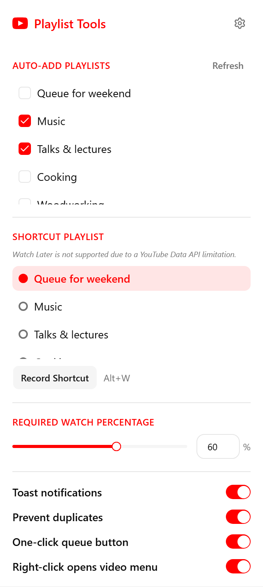
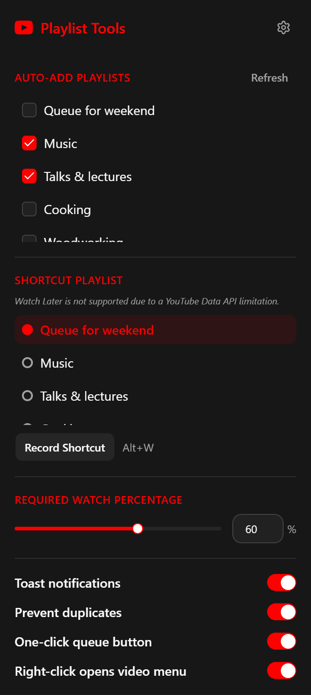
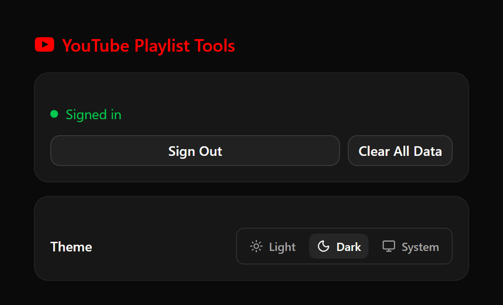

# yt-playlist-tools

A browser extension for Chrome and Firefox that files the YouTube videos you watch into your own playlists. It can auto-add a video after a set watch percentage, add it to a chosen playlist with a shortcut key, and put a one-click **Add to queue** button on thumbnails.

**Install:** [Firefox Add-ons](https://addons.mozilla.org/en-US/firefox/addon/youtube-playlist-tools/)

Using 1.4.5 from Firefox Add-ons? [Setup guide](docs/legacy/1.4.5-setup.md)

  
  
  

## Status

- **Code on `main`:** 1.5.0
- **On Firefox Add-ons:** 1.4.5
- **Next:** 2.0, fully planned and not yet built

2.0 will be called **Perchling for YouTube™**: Google's rules don't allow extensions to be named after YouTube. It's a ground-up rebuild. It works through your own signed-in YouTube session, so you no longer need to set up Google credentials. It also adds YouTube Music quick actions, and every part of it can be switched off. Read the [2.0 spec](.scratch/rebuild/spec.md), or start at the [planning hub](docs/rebuild/README.md).

## Docs

- [Features](docs/features.md): what 1.5.0 does
- [Development](docs/development/README.md): setup, commands, gotchas, tests and CI, releasing
- [Legacy sign-in and token broker](docs/legacy/README.md): retiring in 2.0
- [2.0 planning](docs/rebuild/README.md): the spec, decisions, glossary, research and prototypes
- [Further reading](docs/further-reading.md): external docs, grouped by topic
- [All docs](docs/README.md)
